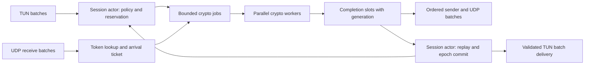
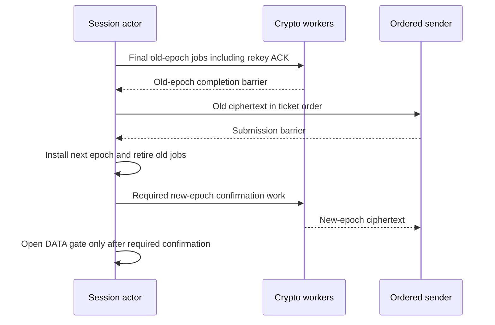

# Winn Protocol v3 Speed Optimization Deep Study: Astra

- **Model**: `gpt-6-astra` (extra high reasoning)
- **Completed**: 2026-09-14 05:13:26 UTC
- **Exit code**: 0
- **Wall clock limit**: 21600s (timed out: False)

## Deep Study Report & Implementation Plan

# Winn Protocol v3: systems and performance engineering study

Author: Astra. Study date: 2026-09-14. Scope: the supplied local source export, its client integrations, and an isolated, tested optimization candidate.

## 1. Finding and decision

Winn v3 has substantial avoidable overhead. Its slow path is not caused by ML-KEM running on every data packet. The main sources are repeated HMAC construction, redundant replay-token computation, packet-buffer allocation and copying, a session mutex spanning both crypto directions, individual socket operations with individual cancellation registrations, and packet-at-a-time host bridges.

The tested first-stage patch reduces the 1,200-byte session benchmark from **46 allocations and 11,232 bytes allocated per packet to 7 allocations and 5,200 bytes**. Median time falls from **4,164 ns to 2,826 ns**, about 32% less elapsed time per operation. A caller-buffer core seal/open pair reaches **0 B/op and 0 allocs/op**, with a final median of **2,283 ns**, compared with 3,559 ns for the original copy-return pair. This is a 36% time reduction and a 1.56x increase in that benchmark's packet rate.

The complete local UDP experiment gives a more restrained result. At four Go execution threads and 32 packets in flight, Winn improves from **125.50 MB/s to 147.39 MB/s**. The pinned AWG fixture reaches **188.07 MB/s**. The candidate therefore reaches about **78% of AWG's measured payload rate** at this boundary. The approximately 17% Winn improvement is useful, but the target remains unmet in that test.

There is no evidence here that production Winn v3 equals or exceeds the owner's deployed AWG connection. There is also no evidence that AWG encryption has zero CPU cost. The owner's reported experience is a valid motivation, not a controlled measurement supplied with this task.

Recommended sequence: land and review the compatible allocation changes, introduce packet ownership through the complete session and host path, remove per-operation cancellation allocation, batch Linux UDP and TUN I/O, then introduce bounded parallel crypto with explicit epoch barriers. Keep the current cryptographic construction and observable padding policy during those steps. Changing the token PRF is a later protocol experiment if HMAC still dominates after these changes.

The complete compilable phase-one patch is included in Appendix A. Parallel crypto, fixed token indexing, GSO/GRO, and native bridge batching are specified as implementation work, not represented as finished code. Production sources were not edited for this study.

## 2. Evidence, scope, and reproducibility

The checkout path is `/Users/owner/.gemini/antigravity/scratch/winn3_speed_lanes/astra`. The inspected module is `winn_protocol_experimental`. This source export does not provide a usable local Git identity, so no commit SHA is invented. [source-sha256.json](winn3_speed_astra/source-sha256.json) records the initial bytes of 1,021 Go source and module files. Source citations below refer to this original export, before the proposed patch.

The measurement host is an Apple M5 Max, 18 logical CPUs, 128 GiB RAM, macOS 26.6.2, build 25G83. The module selects Go 1.27.0 through toolchain selection, despite the outer shell's Go 1.26.5 installation. Its pinned dependencies include `golang.org/x/crypto v0.54.0`, `x/net v0.56.0`, and `x/sys v0.47.0`. These versions were preserved. [Recorded host and toolchain](winn3_speed_astra/host-toolchain.json). [winn_protocol_experimental/go.mod:1](/Users/owner/.gemini/antigravity/scratch/winn3_speed_lanes/astra/winn_protocol_experimental/go.mod:1)

Experiments use separate temporary `baseline` and `candidate` module copies. Their paths are recorded in [lab-path.txt](winn3_speed_astra/lab-path.txt). The original Dart source fixture was copied beside these modules for an existing session conformance test. An initial missing-fixture failure was corrected in the test workspace, not hidden or fixed by weakening the test.

AWG comparison source: the repository's Windows AWG dependency names `v3.1.20260814`. The official tag resolves to commit `1b86b2ae0e493e7ea93f8c1a0f0cb6735b1551f1`. This is a version-pinned comparison, not a claim about the latest AWG release or the exact configuration running on the owner's phone. Tag response, downloaded source hashes, and archive provenance are preserved under [upstream/](winn3_speed_astra/upstream/). See the [official tag](https://github.com/amnezia-vpn/amneziawg-go/tree/v3.1.20260814) and [windows/awg_engine/go.mod:38](/Users/owner/.gemini/antigravity/scratch/winn3_speed_lanes/astra/windows/awg_engine/go.mod:38).

The project policy requested independent Cursor/Grok review lanes. Six read-only requests were launched; all returned usage exhaustion before producing review work. The native delegation attempt also failed to create a thread. No failed lane is counted as an independent review. This report's findings come from local inspection and executed tests.

All performance numbers below are local observations or explicitly labeled arithmetic estimates. Hardware cycle counts, L1/L2 misses, network wire speed, mobile power, and real platform acceptance were not measured. Neither cross-compilation nor a passing race suite supplies that evidence.

## 3. Current architecture and the serialization points

```mermaid
flowchart LR
    A[Platform TUN or packet bridge] --> B[TUN validation and gate]
    B --> C[Session Enqueue: copy and queue]
    C --> D[Loop drain]
    D --> E[Session Poll under d.mu]
    E --> F[Frame assembly and padding]
    F --> G[Core Seal under sendMu]
    G --> H[Carrier Send: cancellation and one socket write]
    H --> I[Network]
    I --> J[Carrier Recv: one socket read and copy]
    J --> K[Loop readLoop]
    K --> L[Session Deliver under d.mu]
    L --> M[Core Open under recvMu]
    M --> N[Replay commit and frame parsing]
    N --> O[Copy DATA and validate inner IP]
    O --> A
```



The core has direction-specific mutexes, but the public session driver wraps `Poll` and `Deliver` in the same `d.mu`. Consequently, moving callers onto more goroutines does not make a single session's crypto parallel. `Poll` holds its lock through tick handling, assembly, and `Seal`; `Deliver` holds it through `Open`, parsing, and frame handling. [winn_protocol_experimental/winn3/core/session.go:96](/Users/owner/.gemini/antigravity/scratch/winn3_speed_lanes/astra/winn_protocol_experimental/winn3/core/session.go:96) [winn_protocol_experimental/winn3/session/driver.go:724](/Users/owner/.gemini/antigravity/scratch/winn3_speed_lanes/astra/winn_protocol_experimental/winn3/session/driver.go:724) [winn_protocol_experimental/winn3/session/driver.go:807](/Users/owner/.gemini/antigravity/scratch/winn3_speed_lanes/astra/winn_protocol_experimental/winn3/session/driver.go:807)

`Loop.drain` emits synchronously. Each packet passes a gate synchronization and carrier lookup before `Send`. `readLoop` similarly calls `Deliver` synchronously, updates gate state, and wakes the writer. `waitForWork` creates a timer when it must wait. The loops themselves contain little direct packet-buffer allocation, but induce the allocation and lock costs in the functions they call. [winn_protocol_experimental/winn3/driver/loop.go:531](/Users/owner/.gemini/antigravity/scratch/winn3_speed_lanes/astra/winn_protocol_experimental/winn3/driver/loop.go:531) [winn_protocol_experimental/winn3/driver/loop.go:564](/Users/owner/.gemini/antigravity/scratch/winn3_speed_lanes/astra/winn_protocol_experimental/winn3/driver/loop.go:564) [winn_protocol_experimental/winn3/driver/loop.go:593](/Users/owner/.gemini/antigravity/scratch/winn3_speed_lanes/astra/winn_protocol_experimental/winn3/driver/loop.go:593) [winn_protocol_experimental/winn3/driver/loop.go:714](/Users/owner/.gemini/antigravity/scratch/winn3_speed_lanes/astra/winn_protocol_experimental/winn3/driver/loop.go:714)

AWG is also not a lock-free system. This pinned implementation creates encryption, decryption, and handshake workers using `runtime.NumCPU()`, rather than directly using `GOMAXPROCS`. It uses ordered peer queues, shared work channels, packet containers, pools, and container mutexes. Sender order is established before crypto completion; the sequential sender waits for the appropriate completed container. On receive, replay validation follows authentication. Those ownership and ordering rules are the useful model to adopt. The literal claim that AWG already uses a lock-free ring for every stage is inaccurate. [AWG worker creation](https://github.com/amnezia-vpn/amneziawg-go/blob/1b86b2ae0e493e7ea93f8c1a0f0cb6735b1551f1/device/device.go#L363), [send queues and workers](https://github.com/amnezia-vpn/amneziawg-go/blob/1b86b2ae0e493e7ea93f8c1a0f0cb6735b1551f1/device/send.go#L453), [receive validation](https://github.com/amnezia-vpn/amneziawg-go/blob/1b86b2ae0e493e7ea93f8c1a0f0cb6735b1551f1/device/receive.go#L491).

### 3.1 The gateway has two different demultiplexing paths

Do not assume every gateway UDP packet traverses `winn3/gateway.Table`. The inspected `cmd/winn3-gateway` server documents address demultiplexing and reads from one UDP socket. It first checks an address-indexed known session, performs separate stranger admission work, and delivers through a carrier pipe. The pipe copies incoming bytes before its bounded enqueue. The cover demultiplexer also has an individual socket receive and a copy into its delivery channel. [winn_protocol_experimental/cmd/winn3-gateway/main.go:28](/Users/owner/.gemini/antigravity/scratch/winn3_speed_lanes/astra/winn_protocol_experimental/cmd/winn3-gateway/main.go:28) [winn_protocol_experimental/cmd/winn3-gateway/main.go:1673](/Users/owner/.gemini/antigravity/scratch/winn3_speed_lanes/astra/winn_protocol_experimental/cmd/winn3-gateway/main.go:1673) [winn_protocol_experimental/cmd/winn3-gateway/main.go:1717](/Users/owner/.gemini/antigravity/scratch/winn3_speed_lanes/astra/winn_protocol_experimental/cmd/winn3-gateway/main.go:1717) [winn_protocol_experimental/cmd/winn3-gateway/main.go:1841](/Users/owner/.gemini/antigravity/scratch/winn3_speed_lanes/astra/winn_protocol_experimental/cmd/winn3-gateway/main.go:1841) [winn_protocol_experimental/winn3/carrier/pipe.go:185](/Users/owner/.gemini/antigravity/scratch/winn3_speed_lanes/astra/winn_protocol_experimental/winn3/carrier/pipe.go:185) [winn_protocol_experimental/cmd/winn3-gateway/cover_demux.go:107](/Users/owner/.gemini/antigravity/scratch/winn3_speed_lanes/astra/winn_protocol_experimental/cmd/winn3-gateway/cover_demux.go:107)

Separately, `winn3/gateway.Table` is already sharded and releases the table shard before entering per-entry authentication. Its entry lock still spans `OpenAt` and token-window publication. A fixed local collision-candidate array bounds lookup candidates. `KeyedSource.TokenAt` already avoids heap allocation, unlike `core.demuxToken`; it still executes complete SHA-256 computations over pre-xored pads. [winn_protocol_experimental/winn3/gateway/table.go:124](/Users/owner/.gemini/antigravity/scratch/winn3_speed_lanes/astra/winn_protocol_experimental/winn3/gateway/table.go:124) [winn_protocol_experimental/winn3/gateway/table.go:477](/Users/owner/.gemini/antigravity/scratch/winn3_speed_lanes/astra/winn_protocol_experimental/winn3/gateway/table.go:477) [winn_protocol_experimental/winn3/gateway/entry.go:147](/Users/owner/.gemini/antigravity/scratch/winn3_speed_lanes/astra/winn_protocol_experimental/winn3/gateway/entry.go:147) [winn_protocol_experimental/winn3/gateway/token.go:120](/Users/owner/.gemini/antigravity/scratch/winn3_speed_lanes/astra/winn_protocol_experimental/winn3/gateway/token.go:120)

Optimize the deployed ingress path first. Otherwise a fast global token table can have no effect on an address-demultiplexed gateway. Retain the token-table design for its actual callers and migration requirements. Capture the chosen gateway executable, flags, carrier, and ingress counters with every future throughput result.

## 4. Allocation ledger and packet ownership

The counts below distinguish stable data traffic from initialization, occasional control traffic, and error handling. They are observations for this toolchain and packet shape, not language-level promises.

| Site in the original path | Allocation or copy mechanism | Frequency and correction |
|---|---|---|
| `core.demuxToken` | Fresh HMAC, hash state, message/sum intermediates | 8 allocations, 536 B per token in the standalone benchmark; keep one keyed hash per direction owner |
| `core.Seal` token and nonce locals | Arrays escape through the `cipher.AEAD` interface | Escape analysis confirms both; write token into packet headroom and keep nonce scratch with its exclusive owner |
| `core.Seal` plaintext and output | Separate `make` buffers and plaintext copy | 2 packet buffers; place length, payload, and cleared padding directly in the final ciphertext storage |
| `openCounterLocked` | Nonce escape, `Open(nil, ...)`, and a second payload copy | Reuse nonce scratch; open into caller storage and return a bounded payload view |
| `tokenWindow.consume` and `retireLow` | Three HMAC calls on an in-order consume: delete received, delete retired, publish future | Reuse the authenticated token and skip re-deleting a consumed entry; cache PRF state |
| `session.Enqueue` | Payload `make` plus `append` of the queue slice | Usually 2 allocations in the one-enqueue/one-poll fixture; use a bounded descriptor ring and explicit lease transfer |
| `session.assemble` | A nil assembly slice grows once for frame header and again for value | Reuse session scratch initially; later assemble directly into a leased packet |
| `core.ParseFrames` | `[]Frame` append growth | Supply frame descriptor scratch or use a validated two-pass iterator |
| `session.handleFrames` DATA | Copies each payload and grows `[][]byte` output | Replace internal copy-return seam with borrowed delivery or transferred packet leases |
| UDP `Recv` | Address representation plus returned datagram copy | Use `ReadFromUDPAddrPort` and caller-owned receive storage |
| UDP `armRead` / `armWrite` | Channel, `context.AfterFunc` state, and escaping closures | 5 allocations and 296 B per arm in the isolated watcher benchmark; move cancellation ownership to the socket generation |
| `Loop.waitForWork` | Timer creation | Per waiting episode, not necessarily per packet; reuse one stopped/drained timer with a single owner |
| `Loop.drain` / `readLoop` | Indirect Poll/Deliver/Send/Recv costs | No hidden claim that every call allocates locally; remove ownership conversions at these boundaries |

Source locations: [winn_protocol_experimental/winn3/core/replay.go:434](/Users/owner/.gemini/antigravity/scratch/winn3_speed_lanes/astra/winn_protocol_experimental/winn3/core/replay.go:434) [winn_protocol_experimental/winn3/core/session.go:347](/Users/owner/.gemini/antigravity/scratch/winn3_speed_lanes/astra/winn_protocol_experimental/winn3/core/session.go:347) [winn_protocol_experimental/winn3/core/session.go:412](/Users/owner/.gemini/antigravity/scratch/winn3_speed_lanes/astra/winn_protocol_experimental/winn3/core/session.go:412) [winn_protocol_experimental/winn3/core/replay.go:583](/Users/owner/.gemini/antigravity/scratch/winn3_speed_lanes/astra/winn_protocol_experimental/winn3/core/replay.go:583) [winn_protocol_experimental/winn3/session/driver.go:664](/Users/owner/.gemini/antigravity/scratch/winn3_speed_lanes/astra/winn_protocol_experimental/winn3/session/driver.go:664) [winn_protocol_experimental/winn3/session/driver.go:1728](/Users/owner/.gemini/antigravity/scratch/winn3_speed_lanes/astra/winn_protocol_experimental/winn3/session/driver.go:1728) [winn_protocol_experimental/winn3/core/frame.go:118](/Users/owner/.gemini/antigravity/scratch/winn3_speed_lanes/astra/winn_protocol_experimental/winn3/core/frame.go:118) [winn_protocol_experimental/winn3/session/driver.go:1880](/Users/owner/.gemini/antigravity/scratch/winn3_speed_lanes/astra/winn_protocol_experimental/winn3/session/driver.go:1880) [winn_protocol_experimental/winn3/carrier/udp.go:420](/Users/owner/.gemini/antigravity/scratch/winn3_speed_lanes/astra/winn_protocol_experimental/winn3/carrier/udp.go:420) [winn_protocol_experimental/winn3/carrier/udp.go:496](/Users/owner/.gemini/antigravity/scratch/winn3_speed_lanes/astra/winn_protocol_experimental/winn3/carrier/udp.go:496).

At 1,200 bytes, the original core seal has 12 allocations: 8 from the PRF, an escaped token, an escaped nonce, plaintext storage, and wire storage. Its matching receive contributes 27: 24 from three PRFs, one nonce, one AEAD output, and one payload result. The 39-allocation core pair grows to 46 at the session layer through queue, assembly, parsing, and delivery containers. The observed profile and escape logs substantiate these sites. [baseline-escape.txt](winn3_speed_astra/baseline-escape.txt), [baseline-alloc-top.txt](winn3_speed_astra/baseline-alloc-top.txt).

Control-plane allocation remains intentional where it is infrequent and bounded. `chunkBlob` allocates chunk values and descriptors; `blobRx` allocates its payload and coverage bitmap; ping/pong values and pending control queues allocate. Handshake records, signatures, rekey ephemeral keys, token-window construction, and epoch AEAD construction also allocate. These must be measured during churn and rekey but are not per-DATA costs. Padding buckets allocate during construction or ceiling changes; their existence does not demonstrate per-packet randomness allocation. Path-MTU notice encoding allocates its fixed-size control messages. The error wrapper constructs formatted errors, which belongs to exceptional-path cost. External mimic-policy callbacks require separate measurement. [winn_protocol_experimental/winn3/session/pathmtu.go:129](/Users/owner/.gemini/antigravity/scratch/winn3_speed_lanes/astra/winn_protocol_experimental/winn3/session/pathmtu.go:129) [winn_protocol_experimental/winn3/session/pathmtu.go:192](/Users/owner/.gemini/antigravity/scratch/winn3_speed_lanes/astra/winn_protocol_experimental/winn3/session/pathmtu.go:192) [winn_protocol_experimental/winn3/session/jitter.go:12](/Users/owner/.gemini/antigravity/scratch/winn3_speed_lanes/astra/winn_protocol_experimental/winn3/session/jitter.go:12) [winn_protocol_experimental/winn3/session/frames.go:137](/Users/owner/.gemini/antigravity/scratch/winn3_speed_lanes/astra/winn_protocol_experimental/winn3/session/frames.go:137) [winn_protocol_experimental/winn3/session/frames.go:159](/Users/owner/.gemini/antigravity/scratch/winn3_speed_lanes/astra/winn_protocol_experimental/winn3/session/frames.go:159) [winn_protocol_experimental/winn3/session/frames.go:207](/Users/owner/.gemini/antigravity/scratch/winn3_speed_lanes/astra/winn_protocol_experimental/winn3/session/frames.go:207) [winn_protocol_experimental/winn3/session/padding.go:44](/Users/owner/.gemini/antigravity/scratch/winn3_speed_lanes/astra/winn_protocol_experimental/winn3/session/padding.go:44) [winn_protocol_experimental/winn3/session/driver.go:2211](/Users/owner/.gemini/antigravity/scratch/winn3_speed_lanes/astra/winn_protocol_experimental/winn3/session/driver.go:2211) [winn_protocol_experimental/winn3/core/session.go:130](/Users/owner/.gemini/antigravity/scratch/winn3_speed_lanes/astra/winn_protocol_experimental/winn3/core/session.go:130)

The stream carrier is a separate performance regime. It already reuses send storage, but receive record storage and per-operation cancellation remain. Ordered stream transport can also introduce head-of-line effects under loss. Optimizing UDP does not automatically optimize the censorship fallback, and changing its framing must preserve cover-protocol behavior. [winn_protocol_experimental/winn3/carrier/stream.go:284](/Users/owner/.gemini/antigravity/scratch/winn3_speed_lanes/astra/winn_protocol_experimental/winn3/carrier/stream.go:284) [winn_protocol_experimental/winn3/carrier/stream.go:355](/Users/owner/.gemini/antigravity/scratch/winn3_speed_lanes/astra/winn_protocol_experimental/winn3/carrier/stream.go:355)

### 4.1 What zero allocation actually requires

The patch offers a zero-allocation core API, not a zero-allocation VPN. Its legacy `Seal` and `Open` still each return a separately owned heap buffer. Session traffic still performs 7 allocations per benchmark operation. The caller-buffer UDP pair still has 10 cancellation-related allocations. Kotlin, Swift, cgo, Wintun, and the OS may allocate outside Go's `B/op` accounting.

Use bounded packet slabs for the hard steady-state target. A packet descriptor should carry a storage index, generation, byte offset, byte length, capacity, epoch generation, and ownership state. A pool owns the slabs; queue entries carry compact descriptors rather than arbitrary growable slices. Reserve enough headroom for token, inner length, frame header, and AEAD tag. Normal MTU traffic belongs in approximately 2 KiB storage classes. GRO aggregates need a separate, much smaller inventory of approximately 64 KiB receive slabs, not 64 KiB multiplied by every queued packet.

`sync.Pool` is useful for optional caches and large setup objects but is not a hard packet inventory. Entries can disappear at GC, so a pool miss can allocate again. Pool pointers such as `*Packet`, rather than boxing a fresh slice header on every `Put`. Never place keyed HMAC, AEAD objects, or sensitive packet leases into a process-global cache that crosses session ownership. [Go sync.Pool contract](https://pkg.go.dev/sync#Pool).

The lifecycle should be `free -> producer-owned -> crypto-owned -> ordered-output-owned -> free`. Receive plaintext moves from crypto to the validating delivery owner, then to the host consumer. A failed authentication does not publish plaintext; clear the affected plaintext storage before returning its lease. A synchronous socket send can release after its return. An asynchronous native call or foreign callback needs an explicit completion before release. Closing a tunnel invalidates its generation, drains workers, clears owned plaintext, and only then returns storage.

For a zero-allocation session seam, preserve the public compatibility methods and add internal leased operations with explicit capacity/error contracts: enqueue a transferred packet, poll into reserved output, and deliver through a synchronous validated callback or preallocated descriptor array. Reserve output capacity before mutating the pending-frame queue. Do not retry partially consumed assembly after `ErrShortBuffer`. Validate the entire authenticated frame stream before invoking any callback, so a malformed trailing frame cannot cause partial DATA delivery that the current parser would reject.

### 4.2 AEAD aliasing and erasure

In-place sealing means `aead.Seal(plain[:0], nonce, plain, token)`, where `plain` starts after the 8-byte token and has enough capacity for the tag. The token is additional authenticated data and is outside the destination region. For opening, destination may begin exactly at `msg[DemuxTokenSize]`; it must not begin at `msg[0]`, which would overlap both the token and the ciphertext at an invalid offset. Go's AEAD contract permits exact plaintext/ciphertext reuse but disallows arbitrary overlap and allows destination contents to change on authentication failure. [Go AEAD contract](https://pkg.go.dev/crypto/cipher#AEAD).

The patch clears reused padding before sealing and returns `plain[start:end:end]` so append through the payload view cannot expose or overwrite trailing padding. Returning a view extends the lifetime of the entire backing buffer; callers must release the lease promptly. The legacy API continues to own its newly allocated backing storage.

The reusable HMAC contains secret keyed hash state. Dropping its reference at wipe does not prove physical erasure of opaque standard-library objects. The existing code already documents this limitation for AEAD state. No stronger key-erasure claim is made here. A future strict-erasure design needs an independently reviewed state representation and compiler/runtime analysis. [winn_protocol_experimental/winn3/core/session.go:186](/Users/owner/.gemini/antigravity/scratch/winn3_speed_lanes/astra/winn_protocol_experimental/winn3/core/session.go:186)

### 4.3 GC, locality, and bandwidth arithmetic

At 90,000 packets/s, 11,232 B/op corresponds to about **1.011 GB/s of Go allocation** for the measured sender-plus-receiver session pair. The candidate's 5,200 B/op corresponds to **468 MB/s**. Object creation falls from **4.14 million/s to 630,000/s**. This is allocation traffic, not retained heap, GC scan bandwidth, or a measured memory-controller rate. A single client direction does not execute the whole pair benchmark.

Each additional full-payload copy at this rate moves at least 108 MB/s of 1,200-byte payload, plus reads and cache effects. Fresh objects, scattered map entries, queue growth, and cross-core handoffs make locality worse in principle. The exact L1/L2 miss rate was not measured. Contiguous slabs and flat token entries reduce indirections; batching amortizes queue ownership transfer; separating frequently written producer and consumer indices limits false sharing. Cache-line padding must follow the target architecture, not a hard-coded assumption that all CPUs have the same line size.

A slab of 256 x 2,048-byte packets occupies 512 KiB before metadata. A pool of 256 x 65,535-byte packets occupies almost 16 MiB. The latter is a poor default for normal MTU traffic. Size the ring from the permitted latency and measured burst depth, and account for both directions and all peers.

Do not disable GC to claim success. Go's collector cost depends on allocation rate, live heap, roots, and the configured heap target. Tune `GOGC` or `GOMEMLIMIT` only after removing packet churn, then report latency and RSS alongside throughput. [Go GC guide](https://go.dev/doc/gc-guide).

## 5. Measurements

### 5.1 Method

Microbenchmarks use five 300 ms repetitions and `GOMAXPROCS=1`. Tables report medians, not confidence intervals. Rates use decimal MB/s and million completed operations/s. `SetBytes` counts inner payload once for a seal/open pair, even though both encryption and decryption execute. No table silently converts that pair into a one-way wire rate.

Core fixtures use fixed synthetic keys solely for isolated measurement. Session fixtures perform a real initial StrictPQ exchange before timing, select `PadNone`, freeze policy time, and raise byte/message rekey thresholds within allowed bounds to isolate established DATA work. The loopback fixture uses real clocks and the ordinary initial handshake, but its short samples do not establish sustained rekey behavior. These are deliberate benchmark controls, not proposed production defaults.

The original first benchmark command had invalid session threshold and UDP size parameters. Its successful core results remain usable; corrected session/carrier runs are in `baseline-bench-corrected.txt`. No failed result is treated as a throughput observation. The early candidate microbenchmarks precede a conservative AEAD destination-alias tightening; `candidate-into-final-bench.txt` contains the subsequent in-place results. Final changes preserve the original UDP comparison's zone-insensitive behavior and avoid allocating legacy seal output before wiped/exhausted checks. The exact resulting patch was reproduced, race-tested, vetted, cross-compiled, and remeasured in `candidate-into-exact-patch-bench.txt`; its caller-buffer results are used below.

| Operation / variant | ns/op | MB/s | Mpps | B/op | allocs/op |
|---|---:|---:|---:|---:|---:|
| HMAC token, original | 234.5 | n/a | 4.265 | 536 | 8 |
| HMAC token, cached | 78.78 | n/a | 12.69 | 0 | 0 |
| Window consume, original | 794.4 | n/a | 1.259 | 1,608 | 24 |
| Window consume, candidate | 221.2 | n/a | 4.521 | 0 | 0 |
| Seal 1200, original | 1,473 | 814.49 | 0.6787 | 3,120 | 12 |
| Seal 1200, candidate compatibility API | 1,310 | 916.05 | 0.7634 | 1,280 | 1 |
| Seal + open 1200, original | 3,559 | 337.14 | 0.281 | 7,304 | 39 |
| Seal + open 1200, candidate compatibility API | 2,838 | 422.8 | 0.3523 | 2,560 | 2 |
| SealInto + OpenInto 1200, final | 2,283 | 525.63 | 0.438 | 0 | 0 |
| AEAD seal only 1200, original reference | 1,002 | 1,197.94 | 0.9983 | 0 | 0 |
| Session 1200, original | 4,164 | 288.17 | 0.2401 | 11,232 | 46 |
| Session 1200, candidate | 2,826 | 424.64 | 0.3539 | 5,200 | 7 |
| Driver drain with synchronous sink, original | 4,209 | 285.09 | 0.2376 | 11,232 | 46 |
| Driver drain with synchronous sink, candidate | 2,828 | 424.28 | 0.3536 | 5,200 | 7 |
| UDP send + receive 1200, original | 14,156 | 84.77 | 0.07064 | 1,876 | 12 |
| UDP send + RecvInto 1200, candidate | 8,266 | 145.17 | 0.121 | 592 | 10 |

Raw inputs: [baseline core](winn3_speed_astra/baseline-bench.txt), [corrected session and carrier](winn3_speed_astra/baseline-bench-corrected.txt), [candidate microbenchmarks](winn3_speed_astra/candidate-bench.txt), [exact-patch caller-buffer results](winn3_speed_astra/candidate-into-exact-patch-bench.txt), [driver drain baseline](winn3_speed_astra/baseline-driver-bench.txt), [driver drain candidate](winn3_speed_astra/candidate-driver-bench.txt).

The raw AEAD result is an approximate lower-level reference. It lacks token generation, replay tracking, frame parsing, TUN handling, syscall work, and the second crypto operation. It cannot be compared directly with AWG's complete datapath. `BenchmarkAstraWindow` calls `consume(counter)` directly; the normal candidate `Open` knows the authenticated token and avoids that additional PRF invocation.

Standalone UDP timing was noisy: original observations spanned 13,747 to 17,956 ns; caller-buffer candidate observations spanned 7,687 to 9,060 ns. The direct address representation changes only one small allocation; these runs do not isolate its causal contribution to the time difference. The stable findings are the allocation sites and the improvement in the larger controlled loopback comparison.

### 5.2 Shared-session versus independent-session scaling

This experiment runs concurrent callers of legacy `Seal`, then repeats with an independent core session per worker. Independent sessions are a multi-session reference, not an implementation of safe parallel crypto inside one session.

| GOMAXPROCS | Original shared ns/op | Candidate shared ns/op | Original independent ns/op | Candidate independent ns/op |
|---:|---:|---:|---:|---:|
| 1 | 1,692.0 | 1,212.0 | 1,499.0 | 1,253.0 |
| 2 | 1,771.0 | 1,436.0 | 940.6 | 686.6 |
| 4 | 1,742.0 | 1,337.0 | 767.3 | 431.9 |
| 8 | 1,686.0 | 1,387.0 | 727.1 | 418.8 |
| 18 | 1,690.0 | 1,386.0 | 788.8 | 412.4 |

The shared session does not scale. Removing allocations improves its serial work but leaves `sendMu` as a serialization point. Independent candidate sessions improve from about 1,253 ns/op at one thread to 432 ns/op at four, then flatten around 413 to 419 ns/op at higher counts. That is strong evidence against promising linear scaling across all 18 logical CPUs. Scheduling, memory traffic, heterogeneous cores, and this benchmark's remaining allocation all matter; this study does not assign each a measured share.

Sources: [baseline scaling](winn3_speed_astra/baseline-scaling-bench.txt), [candidate scaling](winn3_speed_astra/candidate-scaling-bench.txt).

### 5.3 Winn versus pinned AWG through local UDP

Both harnesses send a validated 1,200-byte IPv4 packet through two Go engines and real local UDP sockets, then compare every received payload byte. A channel acknowledgment bounds the outstanding window to 1 or 32 packets. Winn uses the existing copying fake TUN and complete `driver.Loop`; AWG uses its upstream `ChannelTUN` test pair and default test configuration. Neither is a real TUN or a production client binding. The channel adapters have different internals, so the boundary is comparable but not perfectly identical.

AWG's ChannelTUN has a batch size of one. Linux UDP GSO/GRO and Linux TUN offloads are not exercised on this macOS host. AWG launches workers from `NumCPU` even when `-cpu` sets the Go scheduler to 1 or 4. Setup handshakes and warmup are outside the timed region. Three 300 ms samples were taken for each case, sequentially rather than with competing benchmark processes.

| Operation / variant | ns/op | MB/s | Mpps | B/op | allocs/op |
|---|---:|---:|---:|---:|---:|
| baseline, window 1, CPU 1 | 19,023 | 63.08 | 0.05257 | 14,896 | 67 |
| candidate, window 1, CPU 1 | 17,245 | 69.59 | 0.05799 | 7,584 | 26 |
| awg, window 1, CPU 1 | 15,626 | 76.79 | 0.06399 | 1,428 | 5 |
| baseline, window 1, CPU 4 | 25,848 | 46.43 | 0.03869 | 14,897 | 67 |
| candidate, window 1, CPU 4 | 23,708 | 50.62 | 0.04218 | 7,584 | 26 |
| awg, window 1, CPU 4 | 22,882 | 52.44 | 0.0437 | 1,517 | 5 |
| baseline, window 32, CPU 1 | 10,008 | 119.91 | 0.09992 | 14,447 | 58 |
| candidate, window 32, CPU 1 | 8,466 | 141.75 | 0.1181 | 7,127 | 17 |
| awg, window 32, CPU 1 | 8,741 | 137.28 | 0.1144 | 1,483 | 5 |
| baseline, window 32, CPU 4 | 9,562 | 125.5 | 0.1046 | 14,558 | 60 |
| candidate, window 32, CPU 4 | 8,142 | 147.39 | 0.1228 | 7,249 | 19 |
| awg, window 32, CPU 4 | 6,381 | 188.07 | 0.1567 | 1,543 | 5 |

With one execution thread and 32 packets in flight, the candidate's median is slightly above AWG's. With four threads, AWG has a clear lead. A single small local median advantage does not establish protocol parity. At window 1, additional threads actually hurt both implementations in this fixture, illustrating scheduling cost when there is little independent work.

At window 32 and four threads, Winn's median time improves 14.9%, corresponding to a 17.4% rate increase. Its allocation count falls from 60 to 19 per packet. AWG has 5 in this fixture. Those 5 include adapter and socket-path work and do not prove that every AWG production path allocates five times.

Raw logs: [baseline](winn3_speed_astra/baseline-loopback.txt), [candidate](winn3_speed_astra/candidate-loopback.txt), [AWG](winn3_speed_astra/awg-loopback.txt). [loopback-status.json](winn3_speed_astra/loopback-status.json) records successful command exits. All calculated medians are available in [benchmark-medians.json](winn3_speed_astra/benchmark-medians.json).

### 5.4 Profiles and limits of attribution

The baseline allocation profile attributes about 69% of sampled allocation objects cumulatively to `demuxToken`. After the patch, allocations are concentrated in enqueue, DATA delivery, AEAD-owned output, and frame parsing. These sampled shares support the allocation ledger; exact objects/op come from `-benchmem`, not from scaling sampled heap counts.

The CPU profiles are not reliable enough for percentage attribution. `runtime.kevent` accounts for about 82% of baseline samples and 75% of candidate samples, despite the profiled session fixture having no packet socket. This is an unresolved profiling anomaly. It is not evidence that Winn's session spends that share of active CPU doing network I/O. SHA-256's accelerated `blockSHA2`, ChaCha XOR, Poly1305, allocation, and copying appear in the sampled work, but no precise cycle breakdown is claimed. Preserve the raw profiles and reproduce on Linux with PMU counters before prioritizing work by CPU percentage.

## 6. Demux PRF and exact replay indexing

### 6.1 Keep wire-compatible HMAC first

`demuxToken` hashes the 13-byte label `winn3 demux v1` plus an 8-byte big-endian counter using HMAC-SHA-256 and truncates to 8 bytes. The token is also AEAD associated data. [winn_protocol_experimental/winn3/core/replay.go:434](/Users/owner/.gemini/antigravity/scratch/winn3_speed_lanes/astra/winn_protocol_experimental/winn3/core/replay.go:434) [winn_protocol_experimental/winn3/core/transcript.go:69](/Users/owner/.gemini/antigravity/scratch/winn3_speed_lanes/astra/winn_protocol_experimental/winn3/core/transcript.go:69) [winn_protocol_experimental/winn3/core/session.go:412](/Users/owner/.gemini/antigravity/scratch/winn3_speed_lanes/astra/winn_protocol_experimental/winn3/core/session.go:412)

The premise of two SHA-256 compression blocks per fresh HMAC is incomplete. For a 32-byte key, the inner hash processes a 64-byte ipad plus 21 bytes of message, requiring two blocks including final padding. The outer hash processes a 64-byte opad plus a 32-byte digest, also requiring two blocks. That is four compressions per newly constructed HMAC, excluding object construction. Cached chaining states after each pad leave one remaining inner and one remaining outer block per token.

The candidate reuses standard-library HMAC state under the existing direction owner. This toolchain's HMAC `Reset` caches keyed hash states. A persistent input array and `Sum` destination prevent per-token allocation. The measured PRF cost drops from 234.5 ns and 8 allocations to 78.78 ns and zero allocations. The exact API contract does not promise this implementation cost on every future Go release, so preserve the benchmark as a toolchain upgrade check. [Go HMAC implementation](https://go.dev/src/crypto/internal/fips140/hmac/hmac.go).

Compatibility checks compare 80,000 counters across eight synthetic keys plus high-counter boundaries with the original HMAC function. A separate experiment runs the actual baseline and candidate implementations over 3,000 varying, partly padded packets. Their concatenated wire-byte SHA-256 is identical: `92380a97437fba3308bfb6c313de23e24fd2fd09e8b9fee452d89ca89ed7ab47`. This establishes the tested wire outputs, not a proof over every possible input. [baseline wire digest](winn3_speed_astra/baseline-wire.txt), [candidate wire digest](winn3_speed_astra/candidate-wire.txt).

`gateway.KeyedSource` already stores ipad/opad bytes and avoids heap allocation. However, recomputing `sha256.Sum256` over each pad-plus-input still executes all four blocks. Reuse the same reviewed PRF implementation there only after deciding whether the entry owner or the source lock owns its mutable hash state. Do not put a single mutable HMAC behind an `RLock` and allow concurrent `Reset` calls. [winn_protocol_experimental/winn3/gateway/token.go:92](/Users/owner/.gemini/antigravity/scratch/winn3_speed_lanes/astra/winn_protocol_experimental/winn3/gateway/token.go:92) [winn_protocol_experimental/winn3/gateway/token.go:120](/Users/owner/.gemini/antigravity/scratch/winn3_speed_lanes/astra/winn_protocol_experimental/winn3/gateway/token.go:120)

### 6.2 Why a bitmap alone cannot replace the map

The receiver observes an 8-byte pseudorandom token, not a plaintext counter. A circular bitmap answers whether a known counter is used. It cannot invert an HMAC token to obtain that counter. Winn needs both a token-to-counter index and an exact counter replay structure. Scanning 1,024 tokens per packet is not a replacement for constant-time lookup.

The candidate keeps the map and bool ring, reduces PRF calls, and measures zero steady-state allocation during window advance. It does not prove a hard upper bound on Go map maintenance allocations under all churn patterns.

For a fixed-memory implementation, use an owner-local flat hash table containing complete token, counter or counter offset, and occupancy/generation metadata. A counter-indexed ring stores the corresponding token so eviction does not recompute HMAC. Pair it with an exact bitset of consumed counters. A 1,024-counter bitset needs 128 bytes, versus 1,024 bytes for the current bool slice. The lookup index remains substantially larger.

Choose a fixed load factor around 0.5 to 0.7 as an initial experiment, then measure probe lengths and memory. Bounded open addressing or bucketed cuckoo indexing can work, but needs a specified full-table path, collision stash, and rebuild/admission policy. Compare all 64 token bits before selecting a candidate. Never silently overwrite a token collision. If two live counters share a token, retain bounded candidate entries and let AEAD authenticate the correct counter; specify what happens when the collision bound is exhausted. A Bloom or fingerprint filter may reject obvious misses but cannot authorize acceptance or substitute for exact replay state.

A single owner eliminates map locks locally. A global gateway index still needs sharding and generation-safe publication. Readers may take a short shard lock to obtain an immutable hint, release it, authenticate, then revalidate generation and replay under the session owner. Publication must not expose a half-installed epoch. The existing `OpenAt` replay check is an independent safety boundary and must remain. [winn_protocol_experimental/winn3/core/index.go:147](/Users/owner/.gemini/antigravity/scratch/winn3_speed_lanes/astra/winn_protocol_experimental/winn3/core/index.go:147) [winn_protocol_experimental/winn3/gateway/table.go:477](/Users/owner/.gemini/antigravity/scratch/winn3_speed_lanes/astra/winn_protocol_experimental/winn3/gateway/table.go:477)

The default window's out-of-order tolerance is **511 packets**, not 1,024 and not 512. At 90,000 packets/s, that is about 5.68 ms of packet displacement; at 1 Mpps, about 0.511 ms. A fully skipped future-token window can also prevent lookup of subsequent packets until recovery. Queue depth, worker imbalance, and path reordering must fit the configured bound or motivate an explicitly tested window change. A larger window costs PRF work at installation and per-session gateway memory. [winn_protocol_experimental/winn3/core/params.go:164](/Users/owner/.gemini/antigravity/scratch/winn3_speed_lanes/astra/winn_protocol_experimental/winn3/core/params.go:164) [winn_protocol_experimental/winn3/core/replay.go:574](/Users/owner/.gemini/antigravity/scratch/winn3_speed_lanes/astra/winn_protocol_experimental/winn3/core/replay.go:574)

In-order advance is amortized constant work. A forward jump can retire many slots, so do not describe every existing consume as worst-case O(1). The current advance loop is bounded by window policy, and a replacement must retain a bound under authenticated adversarial ordering. [winn_protocol_experimental/winn3/core/replay.go:622](/Users/owner/.gemini/antigravity/scratch/winn3_speed_lanes/astra/winn_protocol_experimental/winn3/core/replay.go:622)

### 6.3 Alternative PRFs are protocol changes

SipHash, AES-based PRFs, and ChaCha-based token streams are experiments requiring a new negotiated suite, domain separation, transcript binding, test vectors, and downgrade handling. They are not drop-in replacements for the current HMAC bytes. AES-NI is an x86 feature; the measured Apple host uses ARM hardware capabilities. Hardware SHA support is already relevant to this benchmark, so compare accelerated implementations on each target before deciding that a different primitive wins.

An AES design would need a dedicated token key, an unambiguous fixed-width epoch/domain/counter input, and a specified truncation. A ChaCha design needs independent key/nonce domains and a correct mapping from packet counter to stream block and token offset, especially when workers precompute batches. An 8-byte token remains 64 bits after either change; using AES internally does not make the exposed token 128 bits. Tokens are routing hints, not substitutes for the AEAD tag.

Batched HMAC precomputation can run on worker-local keyed state without changing the wire format. Measure its extra queue and cache cost against approximately 79 ns per cached token. It may be cheaper to compute one token while assembling a packet than to ship it to a separate goroutine.

## 7. Parallel crypto with epoch and replay correctness

The target is scalable throughput, not a promise of linear scaling across all CPUs. Use a bounded device-wide pool so thousands of peers do not each spawn `NumCPU` workers. Start with the measured effective `GOMAXPROCS`, reserving scheduler capacity for socket and control owners. Sweep worker counts and batch sizes on homogeneous server CPUs and heterogeneous mobile CPUs.



### 7.1 State ownership

| State | Exclusive authority | Worker access |
|---|---|---|
| Session policy, control frames, shaper, handshake/rekey state | Session actor | Immutable job metadata |
| Next send counter and reserved byte budget | Session actor | Assigned counter only |
| Epoch keys and nonce salt | Immutable epoch object with explicit lifetime | Read-only snapshot, worker-local nonce and PRF scratch |
| Replay low edge, consumed bits, token publication | Session actor or one receive commit owner | Lookup hint only; no acceptance mutation |
| UDP socket, deadlines, batch scratch | Socket generation owner | Completed ciphertext lease |
| Packet storage | Exactly one stage at a time | Exclusive lease while cryptography runs |
| TUN gate and route generation | Existing gate authority | Generation checked before final delivery |

The candidate's direction fields are safe only because existing locks serialize them. A parallel implementation must move nonce and mutable PRF scratch to the worker or job; it cannot simply remove `sendMu` and `recvMu`. Standard-library AEAD concurrency assumptions must be checked for the concrete implementation, or provide a per-worker instance for each active epoch. Key lifetime must outlive all referenced jobs.

### 7.2 Transmit reservation and ordered output

1. The actor validates the DATA gate and padding policy, reserves queue and packet storage, and chooses a bounded batch of frames.
2. It reserves unique counters and accounts for every pending message's wire bytes before crossing a rekey threshold. Published and in-flight messages both count against limits. No counter is returned for reuse after assignment, including failed or dropped work.
3. Each job carries session identity, epoch generation, send ticket, counter, padding target, and exclusive packet lease. Workers only perform token derivation and AEAD construction.
4. Completion slots publish readiness with release/acquire synchronization and an absolute generation. The sender emits tickets in reservation order, skipping explicitly canceled tickets without nonce reuse. Bounded completion slots are reserved before counters so a full queue cannot strand unlimited nonce gaps.
5. The sender hands adjacent completed datagrams to the carrier batch. Error handling records exactly which datagrams were submitted; retry uses the already-built ciphertext where allowed, never seals new content with the old counter.

Use SPSC queues between known owners where possible. For a shared worker pool, a bounded channel of batches is an acceptable first implementation. A lock-free MPMC ring adds ABA, wraparound, wakeup, and cancellation complexity and should be justified by measurements. Avoid spinning while one slow worker blocks the next output ticket. A buffered notification plus a bounded ready-slot array makes missing completion visible without burning a core.

### 7.3 Receive authentication and replay commit

Ingress assigns a local arrival ticket and resolves a token to a candidate counter and epoch generation. A worker authenticates into private storage. It does not mark the token used. On completion, the receive owner revalidates epoch identity, replay bounds, unused state, authenticated inner length, and the gate before consuming and delivering.

Two duplicate datagrams may authenticate concurrently. Exactly one can consume at commit. A forged packet with a valid-looking token must not prevent the genuine packet from being tried later. A pending-token optimization therefore cannot permanently reserve a replay slot before authentication; if it suppresses concurrent duplicates, it needs bounded deferral and retry semantics that preserve the genuine arrival.

Preserve receive arrival order when committing worker results. Do not wait for monotonically consecutive decrypted counters: UDP can lose packets, and the current implementation accepts legal out-of-order arrivals without rebuilding missing order. Local arrival tickets recreate today's sequential receive semantics while allowing crypto completion out of order. Slow jobs need bounded timeouts and explicit ticket retirement so one queue cannot stall the entire device.

A packet from a new epoch may already be in the same socket batch as the old-epoch control message that installs it. Eager token lookup can classify it as unknown too early. Keep such unresolved datagrams in a bounded deferred segment until earlier arrival tickets commit, then retry lookup against the now-current epoch. Do not scan arbitrary future keys or open a long-lived old-epoch acceptance path to hide scheduling races.

### 7.4 Rekey barriers and StrictPQ

The initial driver gate prevents DATA until required PQ establishment is complete. `MixPQ` and classical rekey change both directional keys. In-band rekey uses X25519; this is not a fresh ML-KEM encapsulation on every volume rekey. Preserve the existing hybrid secret chain and its security claims without relabeling classical-only refresh as fresh post-quantum post-compromise recovery. [winn_protocol_experimental/winn3/session/driver.go:1837](/Users/owner/.gemini/antigravity/scratch/winn3_speed_lanes/astra/winn_protocol_experimental/winn3/session/driver.go:1837) [winn_protocol_experimental/winn3/session/driver.go:2120](/Users/owner/.gemini/antigravity/scratch/winn3_speed_lanes/astra/winn_protocol_experimental/winn3/session/driver.go:2120) [winn_protocol_experimental/winn3/core/session.go:476](/Users/owner/.gemini/antigravity/scratch/winn3_speed_lanes/astra/winn_protocol_experimental/winn3/core/session.go:476) [winn_protocol_experimental/winn3/core/session.go:511](/Users/owner/.gemini/antigravity/scratch/winn3_speed_lanes/astra/winn_protocol_experimental/winn3/core/session.go:511) [winn_protocol_experimental/winn3/session/driver.go:2204](/Users/owner/.gemini/antigravity/scratch/winn3_speed_lanes/astra/winn_protocol_experimental/winn3/session/driver.go:2204)

The current responder rekey hook executes after the ACK has been sealed under the old epoch. The initiator switches on authenticated ACK and sends a mandatory new-epoch probe; the responder requires new-epoch confirmation before normal DATA resumes. These ordering constraints are part of the protocol's working behavior. [winn_protocol_experimental/winn3/session/driver.go:1824](/Users/owner/.gemini/antigravity/scratch/winn3_speed_lanes/astra/winn_protocol_experimental/winn3/session/driver.go:1824) [winn_protocol_experimental/winn3/session/driver.go:2223](/Users/owner/.gemini/antigravity/scratch/winn3_speed_lanes/astra/winn_protocol_experimental/winn3/session/driver.go:2223) [winn_protocol_experimental/winn3/session/driver.go:2270](/Users/owner/.gemini/antigravity/scratch/winn3_speed_lanes/astra/winn_protocol_experimental/winn3/session/driver.go:2270)



Submission is not remote receipt. UDP loss of the final old-epoch message must still follow the existing bounded retry/close behavior. A local submission barrier makes new worker lifetimes explicit; it does not solve ACK loss by itself. Do not run the old epoch's `after` hook at job enqueue, and do not let a worker independently publish a ratchet. On shutdown or migration, generation checks reject stale completions and all old readers/workers finish before their keys or packet storage are recycled.

The session's default byte trigger is 4 GiB, while the core soft byte limit is 64 GiB and its message limits are separately defined. At 1 Gbit/s, 4 GiB is reached in about 34.36 seconds of counted traffic. Long throughput trials must include repeated rekeys and their gate stalls. Raising the threshold for the microbenchmark is not an optimization recommendation. [winn_protocol_experimental/winn3/session/config.go:98](/Users/owner/.gemini/antigravity/scratch/winn3_speed_lanes/astra/winn_protocol_experimental/winn3/session/config.go:98) [winn_protocol_experimental/winn3/core/params.go:132](/Users/owner/.gemini/antigravity/scratch/winn3_speed_lanes/astra/winn_protocol_experimental/winn3/core/params.go:132)

### 7.5 Fairness and attack cost

Bound in-flight jobs globally and per peer; use fair scheduling between peers and directions. Give control work sufficient priority to complete rekeys without allowing unauthenticated traffic to monopolize expensive crypto. Preserve stranger admission limits and silent authentication failure. Separate handshake CPU admission from established DATA queues. Overload drops must be observable locally without changing the unauthenticated wire response policy.

Instrument queue occupancy, oldest job age, replay-commit failures after authentication, stale generations, epoch barrier time, completion gaps, and per-peer service share. A faster aggregate benchmark that starves a peer or delays route closure is a regression.

## 8. UDP batching, offloads, and cancellation

The present UDP carrier performs an individual socket read or write and arms per-operation cancellation. It takes locks for peer/stat state and timestamps activity. These operations remain after the crypto patch. `Send` chooses connected `Write` or `WriteToUDP`, while `Recv` uses a single datagram read. [winn_protocol_experimental/winn3/carrier/udp.go:363](/Users/owner/.gemini/antigravity/scratch/winn3_speed_lanes/astra/winn_protocol_experimental/winn3/carrier/udp.go:363) [winn_protocol_experimental/winn3/carrier/udp.go:420](/Users/owner/.gemini/antigravity/scratch/winn3_speed_lanes/astra/winn_protocol_experimental/winn3/carrier/udp.go:420) [winn_protocol_experimental/winn3/carrier/udp.go:496](/Users/owner/.gemini/antigravity/scratch/winn3_speed_lanes/astra/winn_protocol_experimental/winn3/carrier/udp.go:496)

### 8.1 Portable batch contract

Add an optional internal batch interface while preserving `Carrier` for stream and unmodified platforms. It should accept caller-owned packet descriptors, return the number consumed, distinguish partial completion from error, and specify ownership until return. Linux can use `golang.org/x/net/ipv4.PacketConn.ReadBatch` and `WriteBatch`, or reviewed raw `recvmmsg`/`sendmmsg` bindings where the library's address conversion or ancillary handling still allocates. These are actual `PacketConn` methods, not public types named `BatchReader` and `BatchWriter`. The repository already pins `x/net`. [ReadBatch documentation](https://pkg.go.dev/golang.org/x/net/ipv4#PacketConn.ReadBatch).

Preallocate `[]ipv4.Message`, each nested `Buffers` slice, per-message address storage where the API permits it, and OOB buffers. Benchmark the wrapper itself: preallocating payloads does not prove zero allocation if address conversion or control parsing allocates internally. Handle IPv4 and IPv6 explicitly. On platforms without the system calls, use a correct single-message fallback and report the effective batch capability.

Treat partial `sendmmsg` progress as real progress. Resume from the first unsent datagram; never resend the already-submitted prefix accidentally. Preserve datagram boundaries and PMTU errors. Retry policy must not duplicate an unbounded stream of ciphertext after an uncertain socket outcome.

For the gateway's shared UDP socket, batching belongs at the single socket owner before dispatch. Per-peer pipes should transfer descriptors or leases into bounded queues. A peer must not set deadlines on the shared descriptor or close it to cancel only its own session.

### 8.2 GSO/GRO details that affect correctness

Linux `UDP_SEGMENT` describes the UDP payload segment size and supports at most 64 segments per send operation. Aggregate payload limits also apply. With a 65,507-byte IPv4 UDP payload ceiling, 1,200-byte segments fit at most 54 complete segments, and 1,400-byte segments fit 46. Thus "64 packets in 64 KB" is not generally true for full MTU packets. AWG enforces both byte and segment limits. [Linux UDP interface](https://man7.org/linux/man-pages/man7/udp.7.html), [AWG coalescing limits](https://github.com/amnezia-vpn/amneziawg-go/blob/1b86b2ae0e493e7ea93f8c1a0f0cb6735b1551f1/conn/bind_std.go#L441).

Each GSO segment must be a complete independently authenticated Winn datagram with its own token and AEAD tag. GSO concatenates ciphertext datagrams for kernel segmentation; it does not concatenate plaintext and seal once. All full segments in an aggregate have equal size, with at most a shorter final segment. Do not reorder packets by padding bucket merely to improve GSO fill. Coalesce adjacent compatible packets and preserve the existing random size distribution. Padding every message to MTU is a censorship-visible protocol-policy change, not a free batching optimization.

`sendmmsg` batching and GSO solve different problems. The former submits multiple datagrams or aggregates in one call, without a single 64 KB limit for the entire message vector. GSO can further reduce kernel per-packet work. NIC hardware support is not a prerequisite for all software segmentation benefits, and an enabled socket option is not proof that the NIC offloaded anything. Record effective support and fallback counters. [Linux segmentation offloads](https://docs.kernel.org/networking/segmentation-offloads.html).

On GRO receive, parse the segment-size control message, reject invalid or zero values, split the aggregate, and preserve a possible smaller final segment. Check `MSG_TRUNC` and `MSG_CTRUNC`; truncated data or missing/truncated ancillary information cannot safely become an ordinary Winn packet. Validate each segment against carrier limits and the minimum protocol length. Never send the whole GRO aggregate into `Session.Open` as one ciphertext.

Detect capabilities per socket and per platform. Fall back on supported error conditions without retrying already-completed messages. Collect batch-size histograms, GSO segment counts, GRO split counts, truncation drops, PMTU failures, and fallback reasons. Linux and Android behavior must be tested on the actual kernel and VPN socket protection path. macOS and Windows need separate implementations; the Linux API is not a portable promise.

### 8.3 Cancellation without five allocations per operation

Use one read owner and one write owner per socket generation, with cancellation watchers registered for their lifetimes. A canceled generation interrupts its owned I/O once. Synchronize watcher completion before resetting deadlines, recycling a descriptor, or installing a new carrier. Preserve caller deadlines through owner scheduling rather than deleting cancellation semantics.

The existing per-operation callbacks deliberately synchronize completion so a late callback cannot poison the next operation's deadline. Replacing them with a goroutine that writes deadlines without a generation barrier reintroduces that race. Migration already carries cancellation and carrier-generation logic; extend that ownership rather than creating an unrelated timer system. [winn_protocol_experimental/winn3/carrier/udp.go:496](/Users/owner/.gemini/antigravity/scratch/winn3_speed_lanes/astra/winn_protocol_experimental/winn3/carrier/udp.go:496) [winn_protocol_experimental/winn3/driver/loop.go:866](/Users/owner/.gemini/antigravity/scratch/winn3_speed_lanes/astra/winn_protocol_experimental/winn3/driver/loop.go:866)

Batch statistic updates with socket ownership. Prefer local counters aggregated periodically over a global mutex on every packet. Retain monotonic activity information needed by timeout policy. Health sampling can be less frequent than DATA accounting if its documented timing bounds remain intact.

### 8.4 Batch size and latency

At 90,000 packets/s, waiting to accumulate 64 packets takes approximately 711 microseconds. That can damage interactive latency. Drain immediately available work in batches of 16 or 32 first. Any coalescing delay should have a small, measured time cap and an immediate flush for control and low-volume interactive traffic. Do not wait indefinitely for a full batch. Sweep batch caps, packet sizes, and concurrency while measuring p50/p95/p99 queue delay and throughput together.

## 9. TUN and client bindings

The platform bridges are part of the performance problem. Go core benchmarks exclude them.

| Platform | Inspected path | Main avoidable cost | Appropriate next design |
|---|---|---|---|
| Android | VpnService file streams, per-generation reader, queue, framed subprocess IPC | ByteArray copies, blocking queue handoff, per-packet framing | Native TUN FD ownership or batched framed IPC with explicit route-generation handoff |
| Windows | Wintun rings in host, inner-IP loopback UDP relay to Winn engine | Extra socket traversal and payload copy between two processes | Embed engine in the ring-owning host or replace relay with bounded shared-memory IPC |
| Apple | NetworkExtension arrays, individual ABI calls, copied Go queues, singleton write arrays | One foreign call and multiple object/copy operations per packet | Batch ABI and `writePackets` arrays with defined C/Swift/Go memory lifetime |
| Linux | Direct inherited TUN FD and gateway TUN forwarding | Individual TUN read/write, single queue, no vnet offload | Multi-queue and virtio-net/offload support after validating interface ownership |

### 9.1 Android

`WinnV3AndroidTun` wraps the device file with `FileInputStream` and `FileOutputStream`. Its reader copies each packet into an `ArrayBlockingQueue`; the bridge reads into another buffer and copies again before frame-channel output. These are the v3-specific paths, not an inferred cost from the older AWG bridge. [android/app/src/main/kotlin/org/winsvpn/app/WinnV3AndroidTun.kt:33](/Users/owner/.gemini/antigravity/scratch/winn3_speed_lanes/astra/android/app/src/main/kotlin/org/winsvpn/app/WinnV3AndroidTun.kt:33) [android/app/src/main/kotlin/org/winsvpn/app/WinnV3AndroidTun.kt:129](/Users/owner/.gemini/antigravity/scratch/winn3_speed_lanes/astra/android/app/src/main/kotlin/org/winsvpn/app/WinnV3AndroidTun.kt:129) [android/app/src/main/kotlin/org/winsvpn/app/WinnV3AndroidTun.kt:155](/Users/owner/.gemini/antigravity/scratch/winn3_speed_lanes/astra/android/app/src/main/kotlin/org/winsvpn/app/WinnV3AndroidTun.kt:155) [android/app/src/main/kotlin/org/winsvpn/app/WinnV3Bridge.kt:238](/Users/owner/.gemini/antigravity/scratch/winn3_speed_lanes/astra/android/app/src/main/kotlin/org/winsvpn/app/WinnV3Bridge.kt:238)

The per-device reader exists for route-rebinding correctness. A descriptor replaced during promotion can leave an old blocking read, so the bridge uses generations and a bounded queue. Passing the TUN FD into native code can remove Java packet copies only if it reproduces descriptor replacement, cancellation, close ownership, and gate behavior. The existing SCM_RIGHTS transfer observed in the host is for a protected socket; it is not proof that this TUN path is already native. [android/app/src/main/kotlin/org/winsvpn/app/WinnV3AndroidTun.kt:84](/Users/owner/.gemini/antigravity/scratch/winn3_speed_lanes/astra/android/app/src/main/kotlin/org/winsvpn/app/WinnV3AndroidTun.kt:84) [android/app/src/main/kotlin/org/winsvpn/app/WinnAndroidEngineHost.kt:544](/Users/owner/.gemini/antigravity/scratch/winn3_speed_lanes/astra/android/app/src/main/kotlin/org/winsvpn/app/WinnAndroidEngineHost.kt:544)

The public VpnService API returns a tunnel descriptor and provides socket protection. It does not promise Linux-style multi-queue TUN configuration to a normal app. Retain `protect` before outer traffic and verify route replacement on the USB-debugging reference phone after implementation. This study changes no Android app source and performs no phone acceptance test. [Android VPN guide](https://developer.android.com/develop/connectivity/vpn), [VpnService.Builder](https://developer.android.com/reference/android/net/VpnService.Builder).

### 9.2 Windows

The host uses `ReceivePacket` with an explicit release closure, and `AllocateSendPacket` followed by a payload copy and `SendPacket`. Wintun already exposes ring-backed packet storage. The additional Winn relay sends inner IP through loopback UDP and receives it again before Wintun delivery. Eliminating that seam can save more than another small Go crypto optimization. [windows/winn3_engine/main_windows.go:487](/Users/owner/.gemini/antigravity/scratch/winn3_speed_lanes/astra/windows/winn3_engine/main_windows.go:487) [windows/winn3_engine/main_windows.go:523](/Users/owner/.gemini/antigravity/scratch/winn3_speed_lanes/astra/windows/winn3_engine/main_windows.go:523) [windows/winn3_engine/relay.go:73](/Users/owner/.gemini/antigravity/scratch/winn3_speed_lanes/astra/windows/winn3_engine/relay.go:73) [windows/winn3_engine/relay.go:112](/Users/owner/.gemini/antigravity/scratch/winn3_speed_lanes/astra/windows/winn3_engine/relay.go:112)

A borrowed Wintun receive packet may be held only until the ring API's release contract permits reuse. Keeping many borrowed packets while workers stall can starve the ring; copying into bounded worker slabs may be faster overall. For inbound packets, authenticate and validate before publishing a Wintun send packet. The decrypted inner length is not available as trusted data before AEAD completion, so blindly decrypting padded ciphertext into a presumed exact-size Wintun allocation is unsafe. [Wintun API documentation](https://github.com/WireGuard/wintun/blob/master/README.md).

Embedding Winn into the Wintun-owning process changes process isolation, privilege ownership, build packaging, and shutdown behavior. Evaluate it against a versioned shared-memory ring with checked offsets and lengths. No raw Go pointer may be retained across process or foreign-runtime boundaries. Maintain the existing route and kill-switch authority independently of worker throughput.

### 9.3 macOS and iOS

`NEPacketTunnelFlow.readPackets` supplies packet arrays, but `WinsWinn3Datapath.swift` iterates them and calls the ABI for each packet. Inbound reads allocate `Data` and eventually call `writePackets([packet], withProtocols: [NSNumber(...)])` individually. The Go ABI device copies into `[][]byte` queues and copies again when dequeuing. [apple/WinsTunnelCore/WinsWinn3Datapath.swift:343](/Users/owner/.gemini/antigravity/scratch/winn3_speed_lanes/astra/apple/WinsTunnelCore/WinsWinn3Datapath.swift:343) [apple/WinsTunnelCore/WinsWinn3Datapath.swift:365](/Users/owner/.gemini/antigravity/scratch/winn3_speed_lanes/astra/apple/WinsTunnelCore/WinsWinn3Datapath.swift:365) [apple/WinsTunnelCore/WinsWinn3Datapath.swift:401](/Users/owner/.gemini/antigravity/scratch/winn3_speed_lanes/astra/apple/WinsTunnelCore/WinsWinn3Datapath.swift:401) [apple/WinsTunnelCore/WinsWinn3Datapath.swift:454](/Users/owner/.gemini/antigravity/scratch/winn3_speed_lanes/astra/apple/WinsTunnelCore/WinsWinn3Datapath.swift:454) [winn_protocol_experimental/cdatapath/winn_datapath_winn3.go:252](/Users/owner/.gemini/antigravity/scratch/winn3_speed_lanes/astra/winn_protocol_experimental/cdatapath/winn_datapath_winn3.go:252) [winn_protocol_experimental/cdatapath/winn_datapath_winn3.go:315](/Users/owner/.gemini/antigravity/scratch/winn3_speed_lanes/astra/winn_protocol_experimental/cdatapath/winn_datapath_winn3.go:315)

Add a versioned batch ABI accepting an array of packet descriptors and an explicit count, then return output packets as a bounded batch for one `writePackets` call. Swift `withUnsafeBytes` pointers are valid only inside their documented lifetime; asynchronous Go work must copy into owned storage or transfer explicitly allocated C-owned memory. Do not retain a temporary Swift pointer or a Go heap pointer through C. Empty batches, invalid lengths, mixed IPv4/IPv6 protocol numbers, shutdown during callback, and backpressure need tests. [Apple packet-array write API](https://developer.apple.com/documentation/networkextension/nepackettunnelflow/writepackets%28_%3Awithprotocols%3A%29).

Keep the supported NetworkExtension interface. Extracting a private utun descriptor is not a portable substitute for API-level batching. A 256-packet queue is about 2.84 ms at 90,000 packets/s, not a quarter second. Correct the misleading queue-duration comment when changing this area; choose the bound from latency and byte inventory. [winn_protocol_experimental/cdatapath/winn_datapath_winn3.go:269](/Users/owner/.gemini/antigravity/scratch/winn3_speed_lanes/astra/winn_protocol_experimental/cdatapath/winn_datapath_winn3.go:269)

### 9.4 Linux

The inherited TUN backend already performs direct file `Read`/`Write`; it does not need an invented loopback-removal optimization. The gateway creates `IFF_TUN | IFF_NO_PI | IFF_TUN_EXCL` and serializes output writes. Neither inspected path configures multi-queue or a virtio-net header/offload contract. [winn_protocol_experimental/cmd/winn-datapath/winn3_device_tunfd_linux.go:110](/Users/owner/.gemini/antigravity/scratch/winn3_speed_lanes/astra/winn_protocol_experimental/cmd/winn-datapath/winn3_device_tunfd_linux.go:110) [winn_protocol_experimental/cmd/winn3-gateway/forward_linux.go:136](/Users/owner/.gemini/antigravity/scratch/winn3_speed_lanes/astra/winn_protocol_experimental/cmd/winn3-gateway/forward_linux.go:136) [winn_protocol_experimental/cmd/winn3-gateway/forward_linux.go:206](/Users/owner/.gemini/antigravity/scratch/winn3_speed_lanes/astra/winn_protocol_experimental/cmd/winn3-gateway/forward_linux.go:206)

Linux multi-queue requires opening additional `/dev/net/tun` descriptors attached to the same interface with `IFF_MULTI_QUEUE`. Preserve exclusive initial creation, verify interface identity and ownership before attaching queues, and roll back partial setup without deleting an unrelated interface. Assign queues consistently enough to avoid artificial flow reordering. [Linux TUN/TAP documentation](https://docs.kernel.org/networking/tuntap.html).

TUN offloads require explicit virtio-net header and checksum/segmentation handling. The driver must convert large offloaded inner packets to correctly checksummed protocol packets, or negotiate a complete compatible path for large segments. Merely increasing the receive buffer is insufficient. A `writev` to TUN is not automatically multiple packet writes; concatenating packet buffers changes packet boundaries unless the device API explicitly supplies batching semantics.

Ordinary TUN is not a general shared-memory packet ring. AF_XDP, packet mmap, and specialized kernel datapaths have different privilege, routing, and device models. They are possible Linux-only research branches after the portable path is fast, not drop-in changes for Android, Windows, or NetworkExtension.

### 9.5 Framed IPC and the facade

The duplex writer holds a mutex and writes its 16-byte header and body separately. These are two `io.Writer.Write` calls; they become two kernel writes only for an unbuffered underlying writer. The reader already reuses a buffer except when capacity grows. Avoid claiming all framing reads allocate anew. A bounded batch frame or a vectored/buffered write can reduce crossings, but must handle partial writes and preserve opcode, length, direction, and session-generation validation. [winn_protocol_experimental/datapath/duplex/duplex.go:206](/Users/owner/.gemini/antigravity/scratch/winn3_speed_lanes/astra/winn_protocol_experimental/datapath/duplex/duplex.go:206) [winn_protocol_experimental/datapath/duplex/duplex.go:263](/Users/owner/.gemini/antigravity/scratch/winn3_speed_lanes/astra/winn_protocol_experimental/datapath/duplex/duplex.go:263) [winn_protocol_experimental/datapath/duplex/duplex.go:342](/Users/owner/.gemini/antigravity/scratch/winn3_speed_lanes/astra/winn_protocol_experimental/datapath/duplex/duplex.go:342)

`clientbinding` is primarily the portable control/facade layer over the relay engine; it does not by itself install every platform device. Its own comments distinguish a working relay carrier from full host readiness. Follow actual packet plumbing rather than attributing every DATA allocation to gomobile simply because the facade is bindable. [winn_protocol_experimental/clientbinding/binding.go:1](/Users/owner/.gemini/antigravity/scratch/winn3_speed_lanes/astra/winn_protocol_experimental/clientbinding/binding.go:1)

## 10. Security and anti-censorship invariants

Keep X25519, ML-KEM-768, transcript/domain binding, admission behavior, AEAD tags, nonce ceilings, replay acceptance, and route gates intact. The current performance patch changes local storage and computation reuse, not these primitives or the wire format.

| Invariant | Required behavior after optimization |
|---|---|
| StrictPQ DATA gate | No DATA before the existing required PQ establishment and confirmation |
| Nonce uniqueness | One irreversible counter reservation per message and epoch; no retry with changed plaintext |
| Authentication before acceptance | Failed tag, invalid length, or stale generation cannot consume replay state or reach TUN |
| Replay independence | `OpenAt` still checks the core's own replay state, even when an external index supplies a hint |
| Epoch lifetime | No key wipe or buffer reuse while old jobs reference it; no accidental old-epoch acceptance grace |
| Padding and cover traffic | Same configured distribution, policy, and probe sizes; batching must not create a new constant-size fingerprint |
| Silent rejection | Unknown token and unauthenticated noise do not gain a response oracle |
| Gate closure | Pending completions cannot cross a revoked route or tunnel generation |
| Resource bounds | Unauthenticated floods cannot allocate an unbounded packet, handshake, or collision queue |

Preserving wire bytes does not prove identical censorship resistance. Batching can change timing and bursts; rerun traffic-shape analysis against the existing cover policy. Compare size distributions, inter-arrival timing, handshake/keepalive patterns, and fallback behavior under loss. Maintain the configured stream fallback rather than declaring UDP-only speed a complete client result.

The final device implementation also needs the project's ruled-route verification and prescribed independent defensive review before any proof deployment. This study neither changes a ruled line nor authorizes a deployment.

## 11. Implementation sequence and acceptance criteria

| Stage | Concrete changes | Completion evidence |
|---|---|---|
| 1. Compatible core and receive scratch | Apply Appendix A in an isolated implementation branch; review lifetime and error contracts | Existing tests, race, wire equivalence, capacity/padding/replay regressions, zero-allocation core benchmark |
| 2. Owned packet and frame storage | Bounded descriptor queues; internal leased Enqueue/Poll/Deliver; full-frame validation before callback | Steady DATA path 0 Go allocations after warmup at both queue-empty and queue-saturated states; pool exhaustion and cancellation tests |
| 3. Socket lifetime and batching | Generation-owned cancellation; optional batch carrier; shared gateway socket batching | Partial-send, cancellation, migration, truncation, IPv6 scope, PMTU and unsupported-platform tests; measured syscall reduction |
| 4. Native host boundaries | Batch Apple ABI; Android native FD or framed batches; Windows relay reduction; Linux queue/offload support | Actual platform packet tests with lifecycle, route changes and kill-switch checks |
| 5. Parallel crypto | Session actor, reservation, completion order, receive commit and epoch barriers | Single-session scaling, hostile ordering tests, long-run rekey trials, fairness and queue latency |
| 6. Token index and gateway scale | Fixed lookup table plus exact bitmap; reduce duplicated index state where caller ownership applies | Collision/exhaustion tests, 1/100/1,000/10,000-peer memory and packet-rate curves |
| 7. End-to-end comparison | Same hosts, path, MTU, cover profiles and offered load for AWG and Winn | Sustained target throughput, latency, CPU, power, loss and security acceptance |

Stages 2, 3, and host-specific stage 4 work can proceed in disjoint copies with a fixed ownership contract. Stage 5 needs one integrator to own nonce/replay/epoch changes. Do not concurrently run Flutter dependency resolution or builds in a shared project directory. Independent review lanes should be counted only after execution is verified.

Suggested performance acceptance targets, explicitly not achieved results: zero steady-state Go packet allocations for the owned core/session/driver path; no regression in p99 latency at the target offered load; no unbounded queue; materially lower syscalls/packet with batching enabled; and Winn payload throughput at least equal to the exact AWG baseline while using no more total CPU or energy at that rate. Require the same censorship profile for claims about the deployed product.

Define "wire speed" using the actual link, MTU, Ethernet overhead and measured usable capacity. At 1 Gbit/s, payload-only arithmetic gives 89,286 packets/s for 1,400 bytes or 104,167 packets/s for 1,200 bytes. At 90,000 packets/s, one fully occupied CPU has about 11.11 microseconds per packet; at 900,000 packets/s, 1.11 microseconds. These are budgets, not measurements.

Winn's unpadded DATA overhead is 8 token + 2 inner length + 3 frame header + 16 tag = 29 bytes before outer IP/UDP. Plain WireGuard transport overhead is 32 bytes before outer IP/UDP and any padding. That three-byte difference is small and does not overcome multiple copies or syscalls. AWG's configured junk, header protection and padding change its actual traffic; the specific configuration must accompany any comparison. [winn_protocol_experimental/winn3/core/session.go:251](/Users/owner/.gemini/antigravity/scratch/winn3_speed_lanes/astra/winn_protocol_experimental/winn3/core/session.go:251) [winn_protocol_experimental/winn3/core/frame.go:88](/Users/owner/.gemini/antigravity/scratch/winn3_speed_lanes/astra/winn_protocol_experimental/winn3/core/frame.go:88) [WireGuard protocol paper](https://www.wireguard.com/papers/wireguard.pdf).

### 11.1 Required benchmark matrix beyond this host

Run both directions and simultaneous full duplex. Use 64, 256, 512, 1,200 and maximum inner-MTU payloads; TCP single flow, TCP multiple flows, and paced UDP with loss measurement. Test one session and many sessions. Hold NIC, host route, outer family, cipher implementation, clock policy, power state, MTU, and padding profile constant.

Use at least five 60-second measured runs after warmup, randomize AWG/Winn run order, and retain complete per-run results. Include a longer trial spanning multiple default byte and time rekeys. Record throughput, offered versus delivered packets, p50/p95/p99 latency, retransmissions, softirq CPU, process CPU, RSS, allocation rate, GC pause/assist time, temperature and power where available. Record packets per syscall and GSO/GRO histograms. A link-limited run needs CPU and latency to distinguish equal throughput from equal efficiency.

On a Linux target with available PMU events, collect cycles, instructions, branch misses, L1 data misses, LLC misses, context switches and migrations. Enumerate supported events before selecting names. Normalize per delivered packet, not per offered packet. Use syscall tracing separately because tracing changes timing. Reproduce mutex and block profiles under shared-session contention, and use a runtime trace to explain queue waits. Those profiles are diagnostic trials, not the reported speed runs.

### 11.2 Required hostile tests for the new architecture

Test completion order permutations, duplicate workers, authentic packets after forged same-token arrivals, counter exhaustion while a batch is reserved, partial sends, canceled jobs, queue-full transitions, worker panic/termination, slow consumers, migration during blocked read, old callback after socket replacement, and close while a native output callback owns storage.

For epochs, test rekey INIT/ACK loss, duplicate controls, simultaneous initiation, new-epoch data in the same receive batch as old-epoch control, stale lookup hints, delayed old worker completion, confirmation timeout, and key wipe after the last reference. For replay, test the exact 511-packet tolerance boundary, sparse holes, forward jumps, table collisions, stash exhaustion, and invariant preservation under long randomized traces against the existing sequential implementation.

For I/O, test truncated datagram and ancillary buffers, malformed GRO size, final short segment, mixed destinations, mixed padded sizes, unsupported offloads, IPv4-mapped IPv6 peers, IPv6 scope handling, and PMTU reduction during queued sends. For buffers, poison padding and recycled storage, verify capacity errors do not consume counters, and prove no TUN write occurs after authentication failure or gate revocation.

## 12. Verification performed

| Check | Result | Scope |
|---|---|---|
| Original core/session/carrier/driver/gateway/TUN tests | PASS | Isolated baseline, corrected fixture layout |
| Candidate tests and race detector | PASS | All six packages; final logs retained |
| Candidate `go vet` | PASS | All six packages |
| Linux amd64 and arm64 compilation | PASS | Core, carrier, session and driver test binaries; no target execution |
| Windows amd64 compilation | PASS | Same four package test binaries; no Wintun execution |
| Cached PRF compatibility | PASS | 80,000 counters plus high-counter boundaries |
| In-place ownership/padding/replay checks | PASS | Short seal buffer, dirty padding, bad tag, retry with genuine packet, bounded result capacity, replay, wipe |
| Actual baseline/candidate wire digest | PASS | 3,000 synthetic packets with varying payload and padding |
| Patch application and byte comparison | PASS | Unified diff applied to a pristine copy and compared with candidate source hashes |
| Core, session, carrier, drain and scaling benchmarks | PASS | Raw results retained; limitations described above |
| Two-engine UDP loopback comparison with AWG | PASS | Payloads verified; three samples per configuration |
| Hardware cycles/cache misses | UNMEASURED | No PMU experiment on this host |
| Linux GSO/GRO and real TUN throughput | UNTESTED | Architecture only |
| Android phone, Wintun host, Apple extension acceptance | UNTESTED | Source inspection only |
| Production AWG parity | NOT ESTABLISHED | Four-thread local candidate remains slower than AWG |
| Independent model review | UNAVAILABLE | Requested lanes failed before review |

The exact-patch preparation log is [reproduction-prepare.txt](winn3_speed_astra/reproduction-prepare.txt). Final checks are in [candidate-race-final-all.txt](winn3_speed_astra/candidate-race-final-all.txt) and [candidate-vet-final.txt](winn3_speed_astra/candidate-vet-final.txt). [source-verification.json](winn3_speed_astra/source-verification.json) confirms all 1,021 original module files remain unchanged. Command records are in [measurement-status.json](winn3_speed_astra/measurement-status.json) and [loopback-status.json](winn3_speed_astra/loopback-status.json). Final race/vet output and patch verification are retained beside those records. Cross-compilation does not validate native drivers or runtime offloads. The patch is suitable for a focused implementation review; it is not a production release approval.

## Appendix A. Exact phase-one Go diff

This unified diff modifies six files across core, carrier, session and driver. It preserves public copy-return APIs while adding caller-buffer methods. It does not remove direction/session locks or implement GSO. The receive scratch is safe because current `Deliver` completes synchronously and copies delivered DATA before the next socket receive. A leased asynchronous delivery API must revise that assumption.

`OpenAt` deliberately retains counter-based replay consumption. An externally supplied counter hint can authenticate a wire AAD token without having used the core's token map lookup. Deleting the arrived token as though it were necessarily the canonical indexed token could leave a consumed entry in the map. The candidate uses the authenticated token shortcut only for the ordinary lookup path.

Apply from an isolated repository root using `patch -p1 -i docs/evidence/winn3_speed_astra/patches/phase1.patch`. The diff has zero context to avoid unrelated source changes; [source hashes](winn3_speed_astra/source-sha256.json) and [candidate hashes](winn3_speed_astra/candidate-source-sha256.json) identify the exact before/after bytes. Recheck against any newer source before applying.

```diff
--- /dev/null
+++ b/winn_protocol_experimental/winn3/core/demux_prf.go
@@ -0,0 +1,32 @@
+package core
+
+import (
+	"crypto/hmac"
+	"crypto/sha256"
+	"encoding/binary"
+	"hash"
+)
+
+// demuxPRF is confined to one existing direction lock. Its hash state is secret.
+// Dropping it has the same GC erasure limitation as the existing AEAD objects.
+type demuxPRF struct {
+	mac   hash.Hash
+	input [len(labelDemux) + 8]byte
+	sum   [sha256.Size]byte
+}
+
+func newDemuxPRF(key *[KeySize]byte) *demuxPRF {
+	p := &demuxPRF{mac: hmac.New(sha256.New, key[:])}
+	copy(p.input[:], labelDemux)
+	// HMAC Reset caches the SHA-256 ipad/opad states on this Go toolchain.
+	p.mac.Reset()
+	return p
+}
+func (p *demuxPRF) token(counter uint64) (out [DemuxTokenSize]byte) {
+	binary.BigEndian.PutUint64(p.input[len(labelDemux):], counter)
+	p.mac.Reset()
+	_, _ = p.mac.Write(p.input[:])
+	sum := p.mac.Sum(p.sum[:0])
+	copy(out[:], sum[:DemuxTokenSize])
+	return out
+}
--- a/winn_protocol_experimental/winn3/core/session.go
+++ b/winn_protocol_experimental/winn3/core/session.go
@@ -6,0 +7 @@
+	"io"
@@ -95,0 +97,3 @@
+	sendPRF     *demuxPRF
+	sendNonce   [AEADNonceSize]byte
+	recvNonce   [AEADNonceSize]byte
@@ -157,0 +162 @@
+	s.sendPRF = newDemuxPRF(&send.demux)
@@ -213,0 +219,3 @@
+	s.sendPRF = nil
+	clear(s.sendNonce[:])
+	clear(s.recvNonce[:])
@@ -323,0 +332,10 @@
+	return s.sealInto(nil, payload, padTo, true)
+}
+
+// SealInto writes one message into dst capacity without allocating packet storage.
+// dst and payload must not overlap. On success the result aliases dst.
+// An insufficient destination does not consume a nonce. Caller owns dst until Send returns.
+func (s *Session) SealInto(dst, payload []byte, padTo int) ([]byte, error) {
+	return s.sealInto(dst, payload, padTo, false)
+}
+func (s *Session) sealInto(dst, payload []byte, padTo int, allocate bool) ([]byte, error) {
@@ -346,8 +364,13 @@
-
-	token := demuxToken(&s.sendDemux, counter)
-
-	var nonce [AEADNonceSize]byte
-	copy(nonce[:nonceSaltSize], s.sendSalt[:])
-	binary.BigEndian.PutUint64(nonce[nonceSaltSize:], counter)
-
-	plain := make([]byte, transportHeaderSize+len(payload)+padLen)
+	if cap(dst) < minLen+padLen {
+		if !allocate {
+			return nil, io.ErrShortBuffer
+		}
+		dst = make([]byte, minLen+padLen)
+	}
+
+	out := dst[:minLen+padLen]
+	token := s.sendPRF.token(counter)
+	copy(out[:DemuxTokenSize], token[:])
+	copy(s.sendNonce[:nonceSaltSize], s.sendSalt[:])
+	binary.BigEndian.PutUint64(s.sendNonce[nonceSaltSize:], counter)
+	plain := out[DemuxTokenSize : len(out)-AEADTagSize]
@@ -356,5 +379,3 @@
-	// Padding stays zero: it is inside the AEAD and therefore unobservable.
-
-	out := make([]byte, DemuxTokenSize, minLen+padLen)
-	copy(out, token[:])
-	out = s.sendAEAD.Seal(out, nonce[:], plain, token[:])
+	clear(plain[transportHeaderSize+len(payload):])
+	sealed := s.sendAEAD.Seal(plain[:0], s.sendNonce[:], plain, out[:DemuxTokenSize])
+	out = out[:DemuxTokenSize+len(sealed)]
@@ -377,0 +399,12 @@
+	return s.openInto(nil, msg, true)
+}
+
+// OpenInto returns authenticated payload as a view of dst. dst capacity must
+// cover the complete decrypted body, including inner length and padding.
+// dst may start exactly at msg[DemuxTokenSize] for in-place opening; otherwise
+// it must not overlap msg. Neither the token nor msg header may be overwritten.
+// On failure dst contents are unspecified, and no plaintext may be delivered.
+func (s *Session) OpenInto(dst, msg []byte) ([]byte, error) {
+	return s.openInto(dst, msg, false)
+}
+func (s *Session) openInto(dst, msg []byte, allocate bool) ([]byte, error) {
@@ -388,0 +422,3 @@
+	if !allocate && cap(dst) < len(msg)-DemuxTokenSize-AEADTagSize {
+		return nil, io.ErrShortBuffer
+	}
@@ -401 +437 @@
-	return s.openCounterLocked(msg, counter)
+	return s.openIntoCounterLocked(dst, msg, counter, true)
@@ -412,0 +449,3 @@
+	return s.openIntoCounterLocked(nil, msg, counter, false)
+}
+func (s *Session) openIntoCounterLocked(dst, msg []byte, counter uint64, tokenResolved bool) ([]byte, error) {
@@ -415,5 +454,3 @@
-	var nonce [AEADNonceSize]byte
-	copy(nonce[:nonceSaltSize], s.recvSalt[:])
-	binary.BigEndian.PutUint64(nonce[nonceSaltSize:], counter)
-
-	plain, err := s.recvAEAD.Open(nil, nonce[:], msg[DemuxTokenSize:], token)
+	copy(s.recvNonce[:nonceSaltSize], s.recvSalt[:])
+	binary.BigEndian.PutUint64(s.recvNonce[nonceSaltSize:], counter)
+	plain, err := s.recvAEAD.Open(dst[:0], s.recvNonce[:], msg[DemuxTokenSize:], token)
@@ -431 +468,5 @@
-	s.recvWindow.consume(counter)
+	if tokenResolved {
+		s.recvWindow.consumeKnown(counter, token)
+	} else {
+		s.recvWindow.consume(counter)
+	}
@@ -434,3 +475 @@
-	out := make([]byte, n)
-	copy(out, plain[transportHeaderSize:transportHeaderSize+n])
-	return out, nil
+	return plain[transportHeaderSize : transportHeaderSize+n : transportHeaderSize+n], nil
--- a/winn_protocol_experimental/winn3/core/replay.go
+++ b/winn_protocol_experimental/winn3/core/replay.go
@@ -468,0 +469 @@
+	prf      *demuxPRF
@@ -482,0 +484 @@
+	w.prf = newDemuxPRF(key)
@@ -484 +486 @@
-		w.tokens[demuxToken(&w.key, c)] = c
+		w.tokens[w.prf.token(c)] = c
@@ -493,0 +496 @@
+	w.prf = nil
@@ -583,0 +587,9 @@
+	var tok [DemuxTokenSize]byte
+	if w.tokens != nil {
+		tok = w.prf.token(counter)
+	}
+	w.consumeKnown(counter, tok[:])
+}
+
+// consumeKnown uses the already authenticated wire token, avoiding a second PRF.
+func (w *tokenWindow) consumeKnown(counter uint64, token []byte) {
@@ -588 +600,3 @@
-		delete(w.tokens, demuxToken(&w.key, counter))
+		var tok [DemuxTokenSize]byte
+		copy(tok[:], token)
+		delete(w.tokens, tok)
@@ -602,0 +617,3 @@
+	if w.tokens != nil && !w.consumed[idx] {
+		delete(w.tokens, w.prf.token(w.low))
+	}
@@ -604,3 +620,0 @@
-	if w.tokens != nil {
-		delete(w.tokens, demuxToken(&w.key, w.low))
-	}
@@ -615 +629 @@
-		w.tokens[demuxToken(&w.key, next)] = next
+		w.tokens[w.prf.token(next)] = next
--- a/winn_protocol_experimental/winn3/session/driver.go
+++ b/winn_protocol_experimental/winn3/session/driver.go
@@ -141,2 +141,3 @@
-	cfg  Config
-	role core.Role
+	assembly []byte
+	cfg      Config
+	role     core.Role
@@ -1733 +1734,5 @@
-	var plain []byte
+	if cap(d.assembly) < budget {
+		d.assembly = make([]byte, 0, budget)
+	}
+	plain := d.assembly[:0]
+	defer func() { clear(d.assembly[:cap(d.assembly)]) }()
--- a/winn_protocol_experimental/winn3/carrier/udp.go
+++ b/winn_protocol_experimental/winn3/carrier/udp.go
@@ -4,0 +5 @@
+	"io"
@@ -420,0 +422,13 @@
+	return u.recvInto(ctx, nil)
+}
+
+// RecvInto receives into caller-owned storage. A full datagram buffer is
+// required so oversized packets are rejected rather than silently truncated.
+// The returned slice aliases dst and remains owned by the caller.
+func (u *UDP) RecvInto(ctx context.Context, dst []byte) ([]byte, error) {
+	if len(dst) < maxRecvDatagram {
+		return nil, io.ErrShortBuffer
+	}
+	return u.recvInto(ctx, dst)
+}
+func (u *UDP) recvInto(ctx context.Context, dst []byte) ([]byte, error) {
@@ -436,0 +451,4 @@
+	buf := dst
+	if buf == nil {
+		buf = u.buf
+	}
@@ -438 +456 @@
-		n, from, err := u.conn.ReadFromUDP(u.buf)
+		n, from, err := u.conn.ReadFromUDPAddrPort(buf)
@@ -448 +466 @@
-		if peer != nil && !sameUDPAddr(from, peer) {
+		if peer != nil && (from.Addr().Unmap().WithZone("") != peer.AddrPort().Addr().Unmap().WithZone("") || int(from.Port()) != peer.Port) {
@@ -465,2 +483,4 @@
-		msg := make([]byte, n)
-		copy(msg, u.buf[:n])
+		msg := buf[:n]
+		if dst == nil {
+			msg = append([]byte(nil), msg...)
+		}
--- a/winn_protocol_experimental/winn3/driver/loop.go
+++ b/winn_protocol_experimental/winn3/driver/loop.go
@@ -593,0 +594,4 @@
+	scratch := make([]byte, 65535)
+	type receiverInto interface {
+		RecvInto(context.Context, []byte) ([]byte, error)
+	}
@@ -597 +601,7 @@
-		msg, err := c.Recv(cctx)
+		var msg []byte
+		var err error
+		if into, ok := c.(receiverInto); ok {
+			msg, err = into.RecvInto(cctx, scratch)
+		} else {
+			msg, err = c.Recv(cctx)
+		}
```


## Appendix B. Complete executable benchmark and regression sources

These are `testing.B` suites and supporting tests, compiled inside the existing packages so they can use package-private constructors and the repository's fake-device harness. Their setup, timer boundaries, metric reporting, and synthetic inputs are visible below. No benchmark disables the production gate in source. The raw AEAD loop intentionally reuses a synthetic nonce solely to time an isolated primitive; this loop is not application code.

Copy common files to the same relative packages in baseline and candidate. Add candidate-only files only after applying Appendix A. AWG's benchmark belongs in the pinned upstream `device` package and uses its existing test helpers. The file mapping and preparation commands are supplied in [reproduce.py](winn3_speed_astra/reproduce.py).

```sh
python3 docs/evidence/winn3_speed_astra/reproduce.py
```

That command creates another temporary workspace and prints its location. It does not patch the production module. To repeat full measurements, use the command arrays and environment overrides in `measurement-status.json`; use the prepared paths printed by the reproducer. For example, run from either prepared module:

```sh
GOMAXPROCS=1 go test ./winn3/core ./winn3/session ./winn3/carrier ./winn3/driver -run '^$' -bench '^BenchmarkAstra(Demux|Window|Seal|RoundTrip|AEAD|Session|UDP|Drain)$' -benchmem -benchtime=300ms -count=5
go test ./winn3/core -run '^$' -bench '^BenchmarkAstraParallel' -benchmem -benchtime=300ms -count=3 -cpu=1,2,4,8,18
go test ./winn3/driver -run '^$' -bench '^BenchmarkAstraLoopback' -benchmem -benchtime=300ms -count=3 -cpu=1,4
```

For the candidate's caller-buffer core benchmark:

```sh
GOMAXPROCS=1 go test ./winn3/core ./winn3/carrier -run '^$' -bench '^BenchmarkAstra(IntoRoundTrip|CachedDemux|UDPInto)' -benchmem -benchtime=300ms -count=5
go test -race ./winn3/core ./winn3/session ./winn3/carrier ./winn3/driver ./winn3/gateway ./winn3/tun
go vet ./winn3/core ./winn3/session ./winn3/carrier ./winn3/driver ./winn3/gateway ./winn3/tun
```

### Common: winn3/core/astra_speed_test.go

```go
package core

import (
	"fmt"
	"golang.org/x/crypto/chacha20poly1305"
	"testing"
)

var astraBytes []byte
var astraToken [DemuxTokenSize]byte

func astraPair(b *testing.B, window int) (*Session, *Session) {
	b.Helper()
	// Fixed, synthetic keys are for isolated crypto measurement only.
	var ch chain
	a, err := newSession(RoleInitiator, ch, DefaultTokenWindow)
	if err != nil {
		b.Fatal(err)
	}
	z, err := newSession(RoleResponder, ch, window)
	if err != nil {
		b.Fatal(err)
	}
	return a, z
}
func astraRate(b *testing.B) { b.ReportMetric(float64(b.N)/b.Elapsed().Seconds()/1e6, "Mpps") }
func BenchmarkAstraDemux(b *testing.B) {
	var key [KeySize]byte
	b.ReportAllocs()
	b.ResetTimer()
	for i := 0; i < b.N; i++ {
		astraToken = demuxToken(&key, uint64(i))
	}
	astraRate(b)
}
func BenchmarkAstraWindow(b *testing.B) {
	var key [KeySize]byte
	w := newTokenWindow(&key, DefaultTokenWindow)
	b.ReportAllocs()
	b.ResetTimer()
	for i := 0; i < b.N; i++ {
		w.consume(uint64(i))
	}
	astraRate(b)
}
func BenchmarkAstraSeal(b *testing.B) {
	for _, n := range []int{64, 512, 1200, 1400} {
		b.Run(fmt.Sprint(n), func(b *testing.B) {
			a, _ := astraPair(b, DefaultTokenWindow)
			p := make([]byte, n)
			b.ReportAllocs()
			b.SetBytes(int64(n))
			b.ResetTimer()
			for i := 0; i < b.N; i++ {
				var err error
				astraBytes, err = a.Seal(p, 0)
				if err != nil {
					b.Fatal(err)
				}
			}
			astraRate(b)
		})
	}
}
func BenchmarkAstraRoundTrip(b *testing.B) {
	for _, n := range []int{64, 512, 1200, 1400} {
		b.Run(fmt.Sprint(n), func(b *testing.B) {
			a, z := astraPair(b, DefaultTokenWindow)
			p := make([]byte, n)
			b.ReportAllocs()
			b.SetBytes(int64(n))
			b.ResetTimer()
			for i := 0; i < b.N; i++ {
				msg, err := a.Seal(p, 0)
				if err != nil {
					b.Fatal(err)
				}
				astraBytes, err = z.Open(msg)
				if err != nil || len(astraBytes) != n {
					b.Fatalf("open: %v, len %d", err, len(astraBytes))
				}
			}
			astraRate(b)
		})
	}
}
func BenchmarkAstraAEAD(b *testing.B) {
	for _, n := range []int{64, 512, 1200, 1400} {
		b.Run(fmt.Sprint(n), func(b *testing.B) {
			var key [32]byte
			a, err := chacha20poly1305.New(key[:])
			if err != nil {
				b.Fatal(err)
			}
			p := make([]byte, n)
			dst := make([]byte, 0, n+a.Overhead())
			nonce := make([]byte, 12)
			b.ReportAllocs()
			b.SetBytes(int64(n))
			b.ResetTimer()
			// Synthetic AEAD-only timing; nonce reuse here is never network traffic.
			for i := 0; i < b.N; i++ {
				astraBytes = a.Seal(dst[:0], nonce, p, nil)
			}
			astraRate(b)
		})
	}
}
```

### Common: winn3/core/astra_parallel_test.go

```go
package core

import "testing"

func BenchmarkAstraParallelSharedSeal(b *testing.B) {
	a, _ := astraPair(b, DefaultTokenWindow)
	payload := make([]byte, 1200)
	b.ReportAllocs()
	b.SetBytes(1200)
	b.ResetTimer()
	b.RunParallel(func(pb *testing.PB) {
		for pb.Next() {
			if _, e := a.Seal(payload, 0); e != nil {
				b.Error(e)
				return
			}
		}
	})
	astraRate(b)
}
func BenchmarkAstraParallelIndependentSeal(b *testing.B) {
	b.ReportAllocs()
	b.SetBytes(1200)
	b.ResetTimer()
	b.RunParallel(func(pb *testing.PB) {
		// Session setup is once per benchmark worker and is amortized, not hidden.
		var ch chain
		a, e := newSession(RoleInitiator, ch, CallerOwnsTokenWindow)
		if e != nil {
			b.Error(e)
			return
		}
		payload := make([]byte, 1200)
		for pb.Next() {
			if _, e = a.Seal(payload, 0); e != nil {
				b.Error(e)
				return
			}
		}
	})
	astraRate(b)
}
```

### Common: winn3/core/astra_wire_test.go

```go
package core

import (
	"crypto/sha256"
	"fmt"
	"testing"
)

func TestAstraBaselineWire(t *testing.T) {
	var ch chain
	a, e := newSession(RoleInitiator, ch, DefaultTokenWindow)
	if e != nil {
		t.Fatal(e)
	}
	h := sha256.New()
	p := make([]byte, 1200)
	for i := 0; i < 3000; i++ {
		for j := range p {
			p[j] = byte(i + j)
		}
		pad := 0
		if i%3 == 0 {
			pad = 1400
		}
		m, e := a.Seal(p, pad)
		if e != nil {
			t.Fatal(e)
		}
		h.Write(m)
	}
	fmt.Printf("ASTRA_WIRE_SHA256=%x\n", h.Sum(nil))
}
```

### Candidate only: winn3/core/astra_candidate_test.go

```go
package core

import (
	"bytes"
	"fmt"
	"io"
	"testing"
)

func TestAstraPRFCompatibility(t *testing.T) {
	for k := 0; k < 8; k++ {
		var key [KeySize]byte
		for i := range key {
			key[i] = byte(i + k*31)
		}
		p := newDemuxPRF(&key)
		for c := uint64(0); c < 10000; c++ {
			if p.token(c) != demuxToken(&key, c) {
				t.Fatalf("token differs at %d", c)
			}
		}
		for _, c := range []uint64{1 << 32, 1 << 63, ^uint64(0)} {
			if p.token(c) != demuxToken(&key, c) {
				t.Fatal("boundary token differs")
			}
		}
	}
}
func TestAstraIntoOwnershipAndReplay(t *testing.T) {
	var ch chain
	a, _ := newSession(RoleInitiator, ch, DefaultTokenWindow)
	legacy, _ := newSession(RoleInitiator, ch, DefaultTokenWindow)
	z, _ := newSession(RoleResponder, ch, DefaultTokenWindow)
	payload := bytes.Repeat([]byte{0x69}, 1200)
	if _, e := a.SealInto(make([]byte, 10), payload, 1400); e != io.ErrShortBuffer {
		t.Fatalf("short buffer: %v", e)
	}
	if a.SendCounter() != 0 {
		t.Fatal("short buffer consumed nonce")
	}
	dst := bytes.Repeat([]byte{0xa5}, 1500)
	for i := 0; i < 3000; i++ {
		msg, e := a.SealInto(dst[:0], payload, 1400)
		if e != nil {
			t.Fatal(e)
		}
		want, e := legacy.Seal(payload, 1400)
		if e != nil || !bytes.Equal(msg, want) {
			t.Fatal("wire mismatch or dirty padding")
		}
		bad := append([]byte(nil), msg...)
		bad[len(bad)-1] ^= 1
		if _, e = z.OpenInto(make([]byte, 1500), bad); e == nil {
			t.Fatal("accepted bad tag")
		}
		original := append([]byte(nil), msg...)
		out, e := z.OpenInto(msg[DemuxTokenSize:DemuxTokenSize], msg)
		if e != nil || !bytes.Equal(out, payload) {
			t.Fatalf("in-place open: %v", e)
		}
		if cap(out) != len(out) {
			t.Fatal("payload view exposes padding")
		}
		if _, e = z.Open(original); e == nil {
			t.Fatal("replay accepted")
		}
	}
	a.Wipe()
	if _, e := a.SealInto(dst, payload, 0); e != ErrWiped {
		t.Fatal("seal after wipe", e)
	}
}
func BenchmarkAstraIntoRoundTrip(b *testing.B) {
	for _, n := range []int{64, 512, 1200, 1400} {
		b.Run(fmt.Sprint(n), func(b *testing.B) {
			a, z := astraPair(b, DefaultTokenWindow)
			p := make([]byte, n)
			dst := make([]byte, n+TransportOverhead())
			b.ReportAllocs()
			b.SetBytes(int64(n))
			b.ResetTimer()
			for i := 0; i < b.N; i++ {
				m, e := a.SealInto(dst[:0], p, 0)
				if e != nil {
					b.Fatal(e)
				}
				out, e := z.OpenInto(m[DemuxTokenSize:DemuxTokenSize], m)
				if e != nil || len(out) != n {
					b.Fatalf("open %v", e)
				}
			}
			astraRate(b)
		})
	}
}
func BenchmarkAstraCachedDemux(b *testing.B) {
	var key [KeySize]byte
	p := newDemuxPRF(&key)
	b.ReportAllocs()
	b.ResetTimer()
	for i := 0; i < b.N; i++ {
		astraToken = p.token(uint64(i))
	}
	astraRate(b)
}
```

### Common: winn3/session/astra_speed_test.go

```go
package session

import (
	"bytes"
	"fmt"
	"testing"
	"time"
	"winsvpn.local/winnprotocol/winn3/core"
)

type astraClock struct{}

func (astraClock) Now() time.Time { return time.Unix(1700000000, 0) }
func astraDrivers(b *testing.B) (*Driver, *Driver) {
	b.Helper()
	a, err := core.GenerateStaticKey()
	if err != nil {
		b.Fatal(err)
	}
	z, err := core.GenerateStaticKey()
	if err != nil {
		b.Fatal(err)
	}
	pub, err := core.NewPublicKey(z.Public())
	if err != nil {
		b.Fatal(err)
	}
	gp := core.GatewayParams{AdmissionKeys: [][]byte{bytes.Repeat([]byte{7}, 32)}, GatewayID: []byte("astra-benchmark")}
	ac := Config{Core: core.Config{Gateway: gp}, Static: a, GatewayStatic: pub, Padding: core.PadNone, Clock: astraClock{}, MaxMessageSize: 1450, RekeyAfterBytes: 1 << 36, RekeyAfterMessages: 1 << 28}
	zc := ac
	zc.Static = z
	zc.GatewayStatic = nil
	zc.Accept = func([]byte) error { return nil }
	tx, err := NewClient(ac)
	if err != nil {
		b.Fatal(err)
	}
	rx, err := NewGateway(zc)
	if err != nil {
		b.Fatal(err)
	}
	for round := 0; round < 100; round++ {
		for _, pair := range [][2]*Driver{{tx, rx}, {rx, tx}} {
			for j := 0; j < 100; j++ {
				m, e := pair[0].Poll()
				if e != nil {
					b.Fatal(e)
				}
				if m == nil {
					break
				}
				if _, e = pair[1].Deliver(m); e != nil {
					b.Fatal(e)
				}
			}
		}
		if tx.State() == StateEstablished && rx.State() == StateEstablished {
			return tx, rx
		}
	}
	b.Fatal("PQ handshake did not establish")
	return nil, nil
}
func BenchmarkAstraSession(b *testing.B) {
	for _, n := range []int{64, 512, 1200, 1400} {
		b.Run(fmt.Sprint(n), func(b *testing.B) {
			tx, rx := astraDrivers(b)
			p := make([]byte, n)
			b.ReportAllocs()
			b.SetBytes(int64(n))
			b.ResetTimer()
			for i := 0; i < b.N; i++ {
				if err := tx.Enqueue(p); err != nil {
					b.Fatal(err)
				}
				m, e := tx.Poll()
				if e != nil || m == nil {
					b.Fatalf("poll %v", e)
				}
				out, e := rx.Deliver(m)
				if e != nil || len(out) != 1 || len(out[0]) != n {
					b.Fatalf("deliver %v count=%d", e, len(out))
				}
			}
			b.ReportMetric(float64(b.N)/b.Elapsed().Seconds()/1e6, "Mpps")
		})
	}
}
```

### Common: winn3/carrier/astra_speed_test.go

```go
package carrier

import (
	"context"
	"net"
	"testing"
)

func BenchmarkAstraUDP(b *testing.B) {
	s, err := net.ListenUDP("udp4", &net.UDPAddr{IP: net.IPv4(127, 0, 0, 1)})
	if err != nil {
		b.Fatal(err)
	}
	defer s.Close()
	ctx, cancel := context.WithCancel(context.Background())
	defer cancel()
	tx, err := DialUDP(ctx, UDPConfig{Remote: s.LocalAddr().(*net.UDPAddr), MaxMessageSize: 1400})
	if err != nil {
		b.Fatal(err)
	}
	defer tx.Close()
	rx, err := NewUDP(UDPConfig{Conn: s, Peer: tx.conn.LocalAddr().(*net.UDPAddr), MaxMessageSize: 1400})
	if err != nil {
		b.Fatal(err)
	}
	p := make([]byte, 1200)
	// Serial loopback datagram exchange is syscall cost, not a wire-speed test.
	b.ReportAllocs()
	b.SetBytes(1200)
	b.ResetTimer()
	for i := 0; i < b.N; i++ {
		if err = tx.Send(ctx, p); err != nil {
			b.Fatal(err)
		}
		m, e := rx.Recv(ctx)
		if e != nil || len(m) != len(p) {
			b.Fatalf("recv %v", e)
		}
	}
	b.ReportMetric(float64(b.N)/b.Elapsed().Seconds()/1e6, "Mpps")
}
func BenchmarkAstraArm(b *testing.B) {
	s, err := net.ListenUDP("udp4", &net.UDPAddr{IP: net.IPv4(127, 0, 0, 1)})
	if err != nil {
		b.Fatal(err)
	}
	defer s.Close()
	u := &UDP{conn: s}
	ctx, cancel := context.WithCancel(context.Background())
	defer cancel()
	b.ReportAllocs()
	b.ResetTimer()
	for i := 0; i < b.N; i++ {
		stop := u.armRead(ctx)
		stop()
	}
	b.ReportMetric(float64(b.N)/b.Elapsed().Seconds()/1e6, "Mpps")
}
```

### Candidate only: winn3/carrier/astra_candidate_test.go

```go
package carrier

import (
	"context"
	"net"
	"testing"
)

func BenchmarkAstraUDPInto(b *testing.B) {
	s, e := net.ListenUDP("udp4", &net.UDPAddr{IP: net.IPv4(127, 0, 0, 1)})
	if e != nil {
		b.Fatal(e)
	}
	defer s.Close()
	ctx, cancel := context.WithCancel(context.Background())
	defer cancel()
	tx, e := DialUDP(ctx, UDPConfig{Remote: s.LocalAddr().(*net.UDPAddr), MaxMessageSize: 1400})
	if e != nil {
		b.Fatal(e)
	}
	defer tx.Close()
	rx, e := NewUDP(UDPConfig{Conn: s, Peer: tx.conn.LocalAddr().(*net.UDPAddr), MaxMessageSize: 1400})
	if e != nil {
		b.Fatal(e)
	}
	p := make([]byte, 1200)
	dst := make([]byte, maxRecvDatagram)
	b.ReportAllocs()
	b.SetBytes(1200)
	b.ResetTimer()
	for i := 0; i < b.N; i++ {
		if e = tx.Send(ctx, p); e != nil {
			b.Fatal(e)
		}
		m, e := rx.RecvInto(ctx, dst)
		if e != nil || len(m) != 1200 {
			b.Fatalf("recv %v", e)
		}
	}
	b.ReportMetric(float64(b.N)/b.Elapsed().Seconds()/1e6, "Mpps")
}
```

### Common: winn3/driver/astra_speed_test.go

```go
package driver

import (
	"bytes"
	"context"
	"fmt"
	"testing"
	"time"
	"winsvpn.local/winnprotocol/winn3/carrier"
	"winsvpn.local/winnprotocol/winn3/core"
	"winsvpn.local/winnprotocol/winn3/session"
)

type astraClock struct{}

func (astraClock) Now() time.Time { return time.Unix(1700000000, 0) }
func astraDrivers(b *testing.B) (*session.Driver, *session.Driver) {
	b.Helper()
	a, err := core.GenerateStaticKey()
	if err != nil {
		b.Fatal(err)
	}
	z, err := core.GenerateStaticKey()
	if err != nil {
		b.Fatal(err)
	}
	pub, err := core.NewPublicKey(z.Public())
	if err != nil {
		b.Fatal(err)
	}
	gp := core.GatewayParams{AdmissionKeys: [][]byte{bytes.Repeat([]byte{7}, 32)}, GatewayID: []byte("astra-benchmark")}
	ac := session.Config{Core: core.Config{Gateway: gp}, Static: a, GatewayStatic: pub, Padding: core.PadNone, Clock: astraClock{}, MaxMessageSize: 1450, RekeyAfterBytes: 1 << 36, RekeyAfterMessages: 1 << 28}
	zc := ac
	zc.Static = z
	zc.GatewayStatic = nil
	zc.Accept = func([]byte) error { return nil }
	tx, err := session.NewClient(ac)
	if err != nil {
		b.Fatal(err)
	}
	rx, err := session.NewGateway(zc)
	if err != nil {
		b.Fatal(err)
	}
	for round := 0; round < 100; round++ {
		for _, pair := range [][2]*session.Driver{{tx, rx}, {rx, tx}} {
			for j := 0; j < 100; j++ {
				m, e := pair[0].Poll()
				if e != nil {
					b.Fatal(e)
				}
				if m == nil {
					break
				}
				if _, e = pair[1].Deliver(m); e != nil {
					b.Fatal(e)
				}
			}
		}
		if tx.State() == session.StateEstablished && rx.State() == session.StateEstablished {
			return tx, rx
		}
	}
	b.Fatal("PQ handshake did not establish")
	return nil, nil
}

type astraSink struct {
	rx        *session.Driver
	delivered int
}

func (s *astraSink) Send(_ context.Context, m []byte) error {
	out, e := s.rx.Deliver(m)
	if e != nil {
		return e
	}
	s.delivered += len(out)
	return nil
}
func (*astraSink) Recv(context.Context) ([]byte, error) {
	return nil, fmt.Errorf("unused benchmark receive")
}
func (*astraSink) Close() error                { return nil }
func (*astraSink) MaxMessageSize() int         { return 1450 }
func (*astraSink) SetMaxMessageSize(int) error { return nil }
func (*astraSink) Class() carrier.Class        { return carrier.ClassUDP }
func (*astraSink) Stats() carrier.Stats        { return carrier.Stats{} }
func BenchmarkAstraDrain(b *testing.B) {
	tx, rx := astraDrivers(b)
	sink := &astraSink{rx: rx}
	l := &Loop{sess: tx, car: sink, wake: make(chan struct{}, 1)}
	ctx := context.Background()
	p := make([]byte, 1200)
	b.ReportAllocs()
	b.SetBytes(1200)
	b.ResetTimer()
	for i := 0; i < b.N; i++ {
		if e := tx.Enqueue(p); e != nil {
			b.Fatal(e)
		}
		n, e := l.drain(ctx)
		if e != nil || n != 1 {
			b.Fatalf("drain %d %v", n, e)
		}
	}
	if sink.delivered != b.N {
		b.Fatalf("delivered=%d want=%d", sink.delivered, b.N)
	}
	b.ReportMetric(float64(b.N)/b.Elapsed().Seconds()/1e6, "Mpps")
}
```

### Common: winn3/driver/astra_loopback_test.go

```go
package driver

import (
	"bytes"
	"context"
	"fmt"
	"net"
	"testing"
	"time"
	"winsvpn.local/winnprotocol/winn3/carrier"
	"winsvpn.local/winnprotocol/winn3/core"
	"winsvpn.local/winnprotocol/winn3/session"
	"winsvpn.local/winnprotocol/winn3/tun"
)

// This shared boundary measures two Go engines, UDP loopback and copying fake
// TUNs. It is not a real TUN, NIC, WAN or production client benchmark.
func BenchmarkAstraLoopback(b *testing.B) {
	for _, window := range []int{1, 32} {
		b.Run(fmt.Sprint(window), func(b *testing.B) {
			a, e := core.GenerateStaticKey()
			if e != nil {
				b.Fatal(e)
			}
			z, e := core.GenerateStaticKey()
			if e != nil {
				b.Fatal(e)
			}
			pub, e := core.NewPublicKey(z.Public())
			if e != nil {
				b.Fatal(e)
			}
			gp := core.GatewayParams{AdmissionKeys: [][]byte{bytes.Repeat([]byte{8}, 32)}, GatewayID: []byte("astra-loopback")}
			size, e := NewSizing(1500, carrier.ClassUDP)
			if e != nil {
				b.Fatal(e)
			}
			socks := make([]*net.UDPConn, 2)
			for i := range socks {
				socks[i], e = net.ListenUDP("udp4", &net.UDPAddr{IP: net.IPv4(127, 0, 0, 1)})
				if e != nil {
					b.Fatal(e)
				}
				defer socks[i].Close()
			}
			devs := []*fakeDevice{newDevice(size.InnerMTU), newDevice(size.InnerMTU)}
			loops := make([]*Loop, 2)
			for i := range loops {
				c, e := carrier.NewUDP(carrier.UDPConfig{Conn: socks[i], Peer: socks[1-i].LocalAddr().(*net.UDPAddr), PathMTU: 1500, MaxMessageSize: size.MessageSize})
				if e != nil {
					b.Fatal(e)
				}
				sc := session.Config{Core: core.Config{Gateway: gp}, Padding: core.PadNone}
				local, router := clientAddr(), gatewayAddr()
				sc.Static = a
				sc.GatewayStatic = pub
				if i == 1 {
					local, router = router, local
					sc.Static = z
					sc.GatewayStatic = nil
					sc.Accept = func([]byte) error { return nil }
				}
				cfg := Config{Session: sc, Carrier: c, Sizing: size, Tun: &tun.Config{Device: devs[i], Assign: tun.Assignment{V4: local, RouterV4: router}}}
				if i == 0 {
					loops[i], e = NewClient(cfg)
				} else {
					loops[i], e = NewGateway(cfg)
				}
				if e != nil {
					b.Fatal(e)
				}
			}
			ctx, cancel := context.WithTimeout(context.Background(), 20*time.Second)
			ended := make(chan error, 2)
			for _, l := range loops {
				go func(l *Loop) { ended <- l.Run(ctx) }(l)
			}
			defer func() {
				cancel()
				for _, d := range devs {
					d.Close()
				}
				for _, l := range loops {
					_ = l.Close()
				}
				for range loops {
					select {
					case <-ended:
					case <-time.After(2 * time.Second):
						b.Error("loop did not stop")
					}
				}
			}()
			deadline := time.Now().Add(5 * time.Second)
			for !(loops[0].Carrying() && loops[1].Carrying()) {
				if time.Now().After(deadline) {
					b.Fatal("PQ setup timeout")
				}
				time.Sleep(time.Millisecond)
			}
			packet := ipv4Packet(clientAddr(), gatewayAddr(), make([]byte, 1180))
			ack := make(chan struct{})
			receiverDone := make(chan error, 1)
			go func() {
				for i := 0; i < b.N; i++ {
					select {
					case got := <-devs[1].out:
						if !bytes.Equal(got, packet) {
							receiverDone <- fmt.Errorf("payload mismatch")
							return
						}
					case <-ctx.Done():
						receiverDone <- ctx.Err()
						return
					}
					if (i+1)%window == 0 || i+1 == b.N {
						select {
						case ack <- struct{}{}:
						case <-ctx.Done():
							receiverDone <- ctx.Err()
							return
						}
					}
				}
				receiverDone <- nil
			}()
			b.ReportAllocs()
			b.SetBytes(1200)
			b.ResetTimer()
			for i := 0; i < b.N; i++ {
				select {
				case devs[0].in <- packet:
				case <-ctx.Done():
					b.Fatal("send timeout")
				}
				if (i+1)%window == 0 || i+1 == b.N {
					select {
					case <-ack:
					case <-ctx.Done():
						b.Fatal("receive timeout")
					}
				}
			}
			b.StopTimer()
			if e := <-receiverDone; e != nil {
				b.Fatal(e)
			}
			b.ReportMetric(float64(b.N)/b.Elapsed().Seconds()/1e6, "Mpps")
		})
	}
}
```

### Pinned upstream AWG: device/astra_loopback_test.go

```go
package device

import (
	"bytes"
	"context"
	"encoding/binary"
	"fmt"
	"testing"
	"time"
)

func BenchmarkAstraAWGLoopback(b *testing.B) {
	for _, window := range []int{1, 32} {
		b.Run(fmt.Sprint(window), func(b *testing.B) {
			pair := genTestPair(b, true)
			pair.Send(b, Ping, nil)
			pair.Send(b, Pong, nil)
			pkt := make([]byte, 1200)
			pkt[0] = 0x45
			binary.BigEndian.PutUint16(pkt[2:4], 1200)
			pkt[8] = 64
			pkt[9] = 17
			copy(pkt[12:16], pair[1].ip.AsSlice())
			copy(pkt[16:20], pair[0].ip.AsSlice())
			var sum uint32
			for i := 0; i < 20; i += 2 {
				sum += uint32(binary.BigEndian.Uint16(pkt[i : i+2]))
			}
			for sum>>16 != 0 {
				sum = (sum & 65535) + (sum >> 16)
			}
			binary.BigEndian.PutUint16(pkt[10:12], ^uint16(sum))
			ctx, cancel := context.WithTimeout(context.Background(), 20*time.Second)
			defer cancel()
			ack := make(chan struct{})
			done := make(chan error, 1)
			go func() {
				for i := 0; i < b.N; i++ {
					select {
					case got := <-pair[0].tun.Inbound:
						if !bytes.Equal(got, pkt) {
							done <- fmt.Errorf("payload mismatch")
							return
						}
					case <-ctx.Done():
						done <- ctx.Err()
						return
					}
					if (i+1)%window == 0 || i+1 == b.N {
						select {
						case ack <- struct{}{}:
						case <-ctx.Done():
							done <- ctx.Err()
							return
						}
					}
				}
				done <- nil
			}()
			b.ReportAllocs()
			b.SetBytes(1200)
			b.ResetTimer()
			for i := 0; i < b.N; i++ {
				select {
				case pair[1].tun.Outbound <- pkt:
				case <-ctx.Done():
					b.Fatal("send timeout")
				}
				if (i+1)%window == 0 || i+1 == b.N {
					select {
					case <-ack:
					case <-ctx.Done():
						b.Fatal("receive timeout")
					}
				}
			}
			b.StopTimer()
			if e := <-done; e != nil {
				b.Fatal(e)
			}
			b.ReportMetric(float64(b.N)/b.Elapsed().Seconds()/1e6, "Mpps")
		})
	}
}
```


## Appendix C. Artifact custody

The report, exact patch, test sources, raw benchmark logs, profile files, upstream provenance, source fingerprints, and validation output form the study bundle. [artifact-sha256.json](winn3_speed_astra/artifact-sha256.json) fingerprints the bundle files. Temporary binaries and the unmodified external AWG checkout are not required for reading the report. Recreate them from the recorded source version when the temporary workspace expires.

The study's production conclusion is bounded: compatible allocation fixes are demonstrated, a meaningful local UDP improvement is measured, and a specific path to further work is defined. Sustained real-platform AWG parity remains to be established by the acceptance matrix above.

